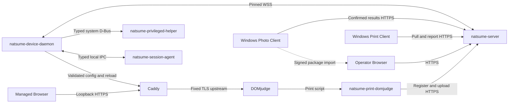

# Natsume V2 目标架构与实施计划

> 状态：`ACCEPTED TARGET` 基线日期：2026-08-28 Session/Home 修订：2026-09-07；GNOME 原生双会话，以 foreground_target 选择等待界面或比赛桌面 平台扩展修订：2026-10-19；统一包布局、持久打印队列与离线队伍拍照，见第 17、23 节 适用范围：Natsume V2 及后续单赛事平台目标；目标不代表已交付 实施策略：既有工位控制基线采用预发布 flag day；平台扩展按独立工作包增量实施，不自动改变已部署契约

本文是仓库中唯一的人工维护架构权威。它同时定义目标系统、模块所有权、安全边界、Device Control 状态模型、目标数据库和实施顺序。部署文档落实配置和维护要求；文档入口见[文档索引](README.md)。Client 必需的运行环境见 [Client 运行环境要求](client-environment.zh-CN.md)；镜像实现、发行版适配和目标机器验收由镜像项目负责。

本文描述的是目标状态，不是完成声明。当前代码与本文冲突时，冲突属于待实施债务，不能反向限制目标架构。

## 1. 权威来源与阅读规则

各类事实只有一个权威来源：

| 事实 | 权威来源 |
|---|---|
| 产品边界、组件职责、数据所有权、安全和实施顺序 | 本文 |
| Device Control wire 字段、field number、presence 与 descriptor | `crates/natsume-workstation-protocol/proto/*.proto` |
| HTTP JSON 的精确字段与表示 | Server HTTP DTO、Serde 实现与 Specta 生成的 TypeScript |
| 本地 IPC 的精确接口 | `crates/natsume-workstation-ipc` 与 D-Bus introspection |
| SQLite 物理表、列、索引与约束 | `crates/natsume-server/migrations/` 中按顺序应用的完整 migration 序列 |
| Diesel 生成类型 | `crates/natsume-server/diesel/schema.rs`，必须由 migration 重建 |
| Device Control `error_code` 字段与开放token语法 | `crates/natsume-workstation-protocol/proto/*.proto` 与 `crates/natsume-workstation-protocol` |
| HTTP公开错误码与status映射 | Server HTTP adapter 与实际 HTTP 测试 |
| 本地IPC typed失败 | `crates/natsume-workstation-ipc` 与各IPC adapter |
| 构建、依赖和发布版本 | Cargo、pnpm、Deno 配置、工具版本清单、打包配置与 lockfile |

表中源码路径指向现有布局；第 17 节定义包含后续工作包的完整目标路径。当前 workspace 索引见 [crates/README.md](../crates/README.md)。XLSX 解析、输入类型和模板归 Server Import 内部，学校 Logo 文件与图像处理归 Server Contest 内部；打印、拍照及共享赛事领域包仍须按各自工作包实施。

规则：

1. 不在第二个 Markdown 文件建立并行架构 authority；PRD 与验证材料引用本文，历史实验不覆盖当前目标语义。
2. Proto 和 migration 是机器可执行契约，但不能自行创造与本文相反的业务语义。
3. 生成代码不能手工编辑。
4. 工位 Device Control 的 migration、Rust adapter、HTTP DTO 或 Web 代码若仍表达 Command、Token、Bundle 或 Observed 旧模型，均视为同步债务；照片成果包不属于旧 credential Bundle。
5. 既有 V2 预发布 flag day 的字段删除、编号压紧规则只适用于该基线，不构成后续平台扩展修改已部署协议或丢弃数据的授权。
6. 历史 flag day 的中间提交不得进入部署包或形成双协议、双 authority、双 schema fallback；后续平台工作包须独立可审阅、可验证，保留现有运行契约。

HTTP DTO 使用 `#[derive(specta::Type)]` 自动收集并导出 TypeScript，不集中维护类型注册表，也不维护平行的 OpenAPI 文档。导出入口为 `export-typescript`，`deno task api` 生成并格式化 Web 类型，CI 检查重新生成的差异。HTTP 方法、路径、认证、状态码和业务校验由实际 adapter 与 HTTP 测试约束；Web 使用明确的具名 HTTP 调用函数，生成类型不承担路由生成或运行时校验。Specta 自动收集需要宏生成的 `unsafe` 初始化函数，Server 仅允许这项生成代码例外，Server 手写 `unsafe` 仍禁止；Windows 打印端仅在 `natsume-print-client/src/backend/` 内允许经隔离、标明安全条件的必要原生接口调用，其他模块继续遵守 workspace 的禁止规则。

## 2. 系统目标与非目标

Natsume 是服务一场现场竞赛的统一运营平台，工位控制目标规模约 500–600 台工作站。 一个 Server 实例只维护当前赛事，不建模多 Event 或跨赛事业务历史。 工位控制、打印、队伍照片是独立领域，共享名单事实，不共享执行生命周期或控制 authority。

系统必须提供：

1. 固定 XLSX 全量导入学校、队伍、Seat、DOMjudge Account 与密码。
2. Device 注册、人工审核、启用、禁用、撤销和重新部署。
3. 现场 Seat→Device Binding。
4. Server Desired State 与 Client Actual State 的持续收敛。
5. Gateway credential 签发、Caddy 配置和 DOMjudge 自动登录。
6. Runtime Config、图形 Session 和 contestant Home 控制。
7. admin/viewer Operator、Web Panel、best-effort可观测性和恢复证据。
8. 网络中断与单进程重启后的确定性恢复。
9. 身份、秘密、证书或本地状态不可证明安全时 fail closed。
10. DOMjudge 入口的持久异步打印队列、空闲 Windows Client 主动领取及提交时排队快照。
11. 首次联网初始化后可离线运行的 Windows 队伍拍照、重照确认、签名交付与当前成品管理。

第 7–14 节的 lease、Input、Target、Actual 和收敛规则特指工位 Device Control。 打印尝试及照片提交的持久事实属于第 23 节，不引入通用命令投递或全局操作审计。

系统明确不提供：

- 多 Server 高可用、分布式共识或多写数据库；
- 多赛事并存、Event timeline 或历史配置快照；
- 通用远程命令、shell、文件管理、任意 systemd 控制；
- 通用 resource/plugin marketplace；
- 动态 JSON/`Any` 控制协议；
- ACME、TOFU 或跳过证书校验的开发回退；
- 对工作站本地 root、物理攻击者或固件篡改的防护；
- 自动 Device merge/split 或静默身份迁移；
- 多桌面环境同时支持；
- 可编辑角色和权限策略；
- 业务审计账本、操作历史或审计Panel；
- 将 UI 遮罩、会话切换或 Caddy 状态页当作强隔离边界。

## 3. 核心设计原则

### 3.1 Authority 明确

Server committed truth、Server Intent、Client Input、Concrete Target 和 Client Actual 是不同事实。任何一层都不能被另一层的消息隐式推进。

### 3.2 完整状态代替操作投递

工位 Device Control 没有 Command delivery plane。远控效果由完整 Desired State 持续收敛，不保存 queued、in-flight、Ack、outcome unknown 或投递历史。 第 23 节的打印请求与有限执行尝试是独立业务队列，不是恢复旧 Device Command。

Operator HTTP Target 提交保留去重 receipt：只记录规范化请求、操作者和已提交的逐设备结果， 不记录 Client 执行、投递、Ack 或历史进度。它保证网络重试不再次推进 terminate/reset epoch。

### 3.3 业务纵向组件化

每项业务拥有自己的规则、数据库访问、事务、Operator 操作和查询。Transport 与 Actor 只调度组件，不理解组件内部状态。

### 3.4 静态类型和静态组合

所有资源在编译期可见。新增 Device Control 资源必须同时增加 Rust 类型、Proto 字段、组件实现、验证和测试。禁止字符串资源名、运行时 downcast、通用 payload 和动态注册表。 独立打印／照片组件使用自身 typed 契约，不为复用控制框架而加入 Device Proto 或 DeviceActor。

### 3.5 Crash-safe、幂等、可重放

每个成功 wire barrier 必须晚于它证明的 durable fact。重复的完整状态不得重复分配 identity、Binding、证书或副作用。

### 3.6 KISS 与 YAGNI

只实现当前系统确实需要的抽象：

- trait 统一同类生命周期，不统一语义不同的业务；
- static dispatch 优先于 trait object；
- 明确调用优先于宏、tuple magic 或通用执行器；
- 一个资源一个组件，不为每个字段或状态创建组件；
- 没有第二个真实消费者时不创建共享 crate；
- 没有测量瓶颈时不并行组件事务；
- 没有跨组件原子不变量时不创建协调事务。

## 4. 系统上下文与进程



### 4.1 `natsume-server`

Server 是唯一业务 authority，拥有：

- Operator 账户、会话和角色；
- Contest Seat、Account、Seat→Account mapping 与 Server vault；
- Import preview/commit；
- Provisioning window；
- Enrollment review 与 Device control key；
- Device lifecycle；
- Binding negotiation 与 occupancy；
- Gateway credential generation 与 Origin CA；
- Runtime、Session 和 Home 的 Server target；
- 当前lease的latest Actual与receive-time，仅存在于对应DeviceActor内存；Client Input 经整体校验和组件消费后丢弃；
- Operator HTTP API、Web 静态资源和 Device WSS；
- 打印请求、就绪队列、领取归属、有限尝试与结果；
- 拍照来源授权、当前成品、待处理候选与成果接收。

第 4.2–4.4 节保留已安装进程名称；Cargo 包的领域化命名见第 17 节，不隐式重命名部署入口。

Server 不直接操作工作站文件、Caddy、图形 Session 或 Home。

### 4.2 `natsume-device-daemon`

Daemon 是工作站系统级协调器，拥有：

- identity-before-credentials 启动；
- control key、Enrollment recovery marker；
- Gateway private key、CSR 与证书 artifact；
- pinned WSS 连接；
- 完整 Client Input/Actual 发布；
- 完整 Server Target 分发；
- 各资源 Client Reconciler；
- Caddy 配置生成、validate、reload 和 LKG；
- 与 Helper、Session Agent 的 typed IPC；
- 离线安全稳态。

Daemon 不把网络字段直接解释成任意路径、UID、unit、命令或配置片段。

### 4.3 `natsume-privileged-helper`

Helper 只提供封闭的 root capability：

- 读取固定硬件身份来源；
- 对固定 waiting/contest 角色执行受限 Session 查询、激活和恢复，仅对 contest 执行 Home 操作；
- 对固定目录和固定 policy 执行必要的特权文件操作。

Helper 不联网，不持有 DOMjudge 密码、control private key、Gateway private key 或 Server trust decision，不接受任意 shell、路径、UID、unit 或环境变量。

### 4.4 `natsume-session-agent`

waiting 使用发行版官方 GNOME Kiosk 的原生 Wayland 会话（当前入口 `gnome-kiosk-script-wayland`），contest 使用完整 GNOME（`ubuntu-wayland`）。Agent 由 Kiosk 的 `org.gnome.Kiosk.Script.service` 启动，包内固定 drop-in 将 ExecStart 指向 Agent，并限制为 waiting 用户。Agent 拥有：

- 普通等待时的全屏静态占位：本期默认纯黑色块，也可由镜像随包提供单张 ICPC logo，缺图时回退纯黑；
- 既有部署 Binding 窗口；
- Binding pending状态；
- 未绑定、不可继续或本地 IPC 失联时的只读诊断展示与离线二维码；
- 窗口生命周期、首帧就绪和 UI lease。

等待占位复用现有 Slint/Skia 渲染能力，保持一个随窗口尺寸变化的无装饰全屏窗口。普通等待、重置和恢复期间均可显示同一占位，不要求动态文案、进度条或动画；详细状态由 Panel/Actual 展示。Binding 是既有部署流程的专用页面，不新增绑定协议。未来复杂 Skia 页面只替换 Agent 内的等待内容；本期不预建页面插件、主题协议或远程图片下发能力。

Agent 不连接 Server，不管理 Caddy，不读取 credential；不自行启动或控制用户服务。“显示等待界面 / 显示比赛桌面”由 Daemon 通过 Helper 激活 waiting/contest 实现，不调用桌面 Lock/Unlock，也不向 Agent 发送会话切换命令。失联撤销 Binding 输入并保留占位，不能隐藏窗口暴露可操作桌面。

GNOME Kiosk 的用户服务是 Agent 的唯一启动与重启所有者；不同时使用全局 XDG Autostart、Agent RegisterClient 或另一个 keeper。服务配置 `Restart=always`、1 秒间隔及 60 秒内最多 5 次启动。Daemon 根据连续展示故障观测冷却至少 60 秒，再请求 Helper 自动重建 waiting；任何可信的就绪观测均结束该连续故障区间。Helper 持有本次 boot 最多一次的恢复预算，不因 lease 更新或服务重启而重置。再次失败报告展示不可用，等待维护；不终止 contest 或重启 GDM。若捕获的旧 waiting 已消失且 GDM 已自动建立唯一、健康的新 waiting，Helper 复用它并完成持有的恢复窗口，保留已消耗预算，不追杀 replacement。waiting readiness 核对 SessionManager 与 Kiosk，contest 核对 SessionManager 与 Shell；两边还需同一 compositor 的 Wayland 协议响应及有效输出；前台额外核对电源和输入能力。Agent 的当前首帧与 lease 仍是独立必要条件，显示尺寸改变时撤销旧帧并等待实际重绘。

### 4.5 Caddy、Browser 与 DOMjudge

Caddy 只负责本机数据面：

- 固定 loopback HTTPS origin；
- 加载 Server 授予的 Gateway leaf；
- BLOCKED 503响应；
- 代理固定 HTTPS DOMjudge upstream；
- 只在 `/login` 注入`X-DOMjudge-Login`和base64编码的`X-DOMjudge-Pass`；
- 在 `/api/*` 注入当前 Binding 的 HTTP Basic Authorization（base64 编码的 `username:password`），覆盖请求自带的 Authorization，并清除 `X-DOMjudge-*` 登录头；API 权限仍由 DOMjudge 按队伍身份判断；
- 其他 route 不注入 credential。

Runtime Config 的 DOMjudge HTTPS origin 只由Server部署配置提供和修改，不暴露 Operator HTTP/Web mutation。它不能改变Control Endpoint、Server trust root或Gateway hostname；这些都是部署期不可远程修改的bootstrap参数。

## 5. 信任、身份与秘密

### 5.1 信任边界

| 边界 | 认证 | 失败策略 |
|---|---|---|
| Operator → Server | 数据库中的 Operator session 与固定角色 | 拒绝，按可观测性规则记录诊断结果 |
| Device → Server | pinned server-auth TLS + connection challenge + Ed25519 proof | protobuf 前后均 fail closed |
| Daemon → Helper | system D-Bus policy + 封闭方法 | 拒绝，不降级 |
| Agent ↔ Daemon | 总线调用者 PID/UID + 精确 waiting boot/session + typed IPC | stale Session/lease 失效 |
| Browser → Caddy | loopback HTTPS | BLOCKED 或不可用 |
| Caddy → DOMjudge | 固定 HTTPS upstream | 非 TLS、验证失败或配置不完整时 BLOCKED |

### 5.2 Machine identity

Machine Hardware ID 是自然键和路由证据，不是认证凭据。

Client 使用固定三个来源：

1. DMI system UUID；
2. DMI motherboard serial；
3. 第一块 system disk serial。

经过固定 normalization、placeholder 拒绝和 2-of-3 判定后，以 Helper 内固定的 Natsume 命名空间 `de1ae196-317f-5204-880f-0b5256c98ce6` 派生 UUIDv5。该常量由 `UUIDv5(NAMESPACE_URL, "urn:natsume:machine-hardware-id:v1")` 固定，不能随版本或部署改变；相同硬件证据跨部署得到相同 Hardware ID。配置和本地 IPC 不接收站点 UUID，identity.json 只保存 machine_hardware_id。原始 serial 不发往 Server、不写日志、不进入 fixture。Enrollment wire 只携带派生 Hardware ID 外层 proof context和 aggregate `MEDIUM`/`STRONG` advisory quality。

无法形成 quorum 时必须停止 identity-bound adapter 初始化；不得读取旧 credential 后猜测身份。

### 5.3 PKI

存在两个不同的根：

| 根 | 私钥位置 | 用途 |
|---|---|---|
| Control Root | 离线，不在运行中 Server | 签发 Server TLS leaf |
| Local Origin CA | Server 私有状态目录 | 在 Active Session 中签发每台 Device 的 Gateway leaf |

Server TLS leaf 必须包含部署实际 Control Endpoint 的 IP-SAN。Server 只读取离线提供的 leaf/key，不自签、不自动生成回退。

### 5.4 秘密边界

秘密包括：

- Operator password、session cookie、邀请注册 token 和密码重置 token；
- Server vault master key；
- DOMjudge password；
- Device control private key；
- Gateway private key；
- Server TLS private key；
- Local Origin CA private key。

秘密不得进入：

- 普通 `Debug`、日志、trace、metric；
- HTTP 普通响应；
- Client Input 或 Actual State；
- Client 通用 target journal；
- 错误 source chain；
- 命令行参数、环境变量或包管理脚本。

Server vault 使用 application-level XChaCha20-Poly1305 current-fact 加密；`accounts` 是 vault row 的父表。Client credential 依赖 root-owned 严格权限文件、原子写入与目录权限；当前 threat model 明确不抵抗本地 root。

## 6. 领域 authority 与数据所有权

| 事实 | Owner | 备注 |
|---|---|---|
| Seat、Account、Seat→Account | Contest/Import Component | Import 唯一修改者 |
| Account password ciphertext/revision | Contest/Import + Vault | plaintext 只存在于短生命周期内存 |
| Device lifecycle | Device Component | enabled/disabled/revoked |
| Pending Enrollment review | Device Component memory registry | 仅当前WSS连接有效，Server生成`review_id`供Panel定位 |
| Device control key | Device Component | activation事务后才是durable authority，和Gateway解耦 |
| Gateway generation/grant | Gateway Component | 每 Device 至多一个 current generation |
| Binding negotiation/occupancy | Binding Component | Binding ID 是每次 occupancy 的 UUID |
| Runtime Config | Runtime Config Component | 当前 DOMjudge HTTPS origin |
| Session target | Session Control Component | foreground target + terminate epoch |
| Home target | Home Component | reset epoch |
| 当前lease的latest Actual与receive-time | DeviceActor memory | fresh snapshot；Input消费后丢弃，重连或重启后必须重报 |
| Active control lease | DeviceActor | 只在内存，不持久化 |
| 打印请求、队列及执行尝试 | Print Component | durable；领取原子化，旧尝试报告不得推进新尝试 |
| 打印系统任务及设备观察 | Print Client | 不等于物理出纸证明，不能覆盖 Server 的领取 authority |
| 拍摄组、已知收图、候选及现场确认 | Photo Client local workspace | 离线持久化，确认绑定具体队伍与图片 |
| 当前照片、待处理候选及照片接收结果 | Photo Component | 与当前名单核对，不按导入时间静默覆盖 |
| 新业务客户端授权 | 对应 Print／Photo 边界 | 独立、最小权限，不复用工位 key 或管理员会话 |

Import 不修改 Binding，不创建远端操作，不产生 Device I/O。Binding 和 Gateway 互不授予对方 authority。Client Input 和 Actual 都是不可信报告。

## 7. Device Control 统一状态模型

所有 Active 资源遵守：

```text
ConcreteTarget = Resolve(ServerIntent, ClientInput)
ActualState    = Reconcile(ConcreteTarget)
```

其中：

- `ServerIntent` 是组件内部的完整 Server truth/policy 视图；
- `ClientInput` 是 Client 对当前协商 generation 的不可信输入；
- `ConcreteTarget` 是 Server 给 Client 的完整精确目标；
- `ActualState` 是 Client Reconciler 应用、验证并重新采样后的事实。

Actual State 不进入当前 `Resolve`。当 Actual 需要推动 Server lifecycle 时，组件内部的 Intent Policy 产生 typed transition：

```text
NextServerIntent = DeriveIntent(ServerTruth, Policy, ActualState)
```

transition 必须先提交，再从新 truth 重新 Resolve。不得从提交前推测下一 Target。

### 7.1 四个 wire plane

Server 完整快照：

```text
ServerStateSnapshot
  intent: ServerIntentState
  target: ConcreteTargetState
```

Client 完整快照：

```text
ClientStateSnapshot
  input: ClientInputState
  actual: ActualState
```

规则：

- 每帧 replace latest，不是 delta；
- 缺字段表达协议定义的 exact absence，绝不继承旧帧；
- `ConcreteTargetState` 和 `ActualState` 的资源字段语义校验后必须完整；
- Unit-input 资源不伪造空 Intent/Input wire message；
- 无全局 snapshot revision、configuration clock 或 resource version；
- 关联使用资源自己的 `credential_id`、`negotiation_id`、`binding_id`、`credential_revision` 和 epoch；
- 重复相同状态必须是 no-op。

### 7.2 Level 与 Transition

Level 持续要求 exact convergence：

- Gateway leaf；
- Binding access；
- Runtime Config；
- Session 前台选择（`foreground_target`：waiting 显示等待界面，contest 显示比赛桌面）。

Transition 通过单调 epoch 表达需要至少执行一次的目标：

- terminate Session；
- reset Home。

Level 和 Transition 都属于 Concrete Target，不形成第二套 Command 模型。

## 8. WSS、Enrollment 与 Session lease

### 8.1 Transport

Operator HTTPS 与 Device WSS 可以共用一个 Server listener。Device 只连接固定 `/api/v2/device/control` route，并使用唯一 pinned `natsume.control.v3` WSS subprotocol。 每个完成重组的 Protobuf frame 最多 65,536 bytes。这个上限同时适用于 Handshake 与 Active frame，不再为单个消息类型建立重复上限。一个 wire generation 只有一个 descriptor，不维持旧/新双栈。

`ClientProof.signature` 是 Ed25519 对下列 32-byte SHA-256 digest 的签名：

```text
SHA-256(
    "NATSUME-DEVICE-CONTROL-CLIENT-PROOF\0" ||
    0x01 ||
    UTF-8("/api/v2/device/control") || 0x00 ||
    UTF-8("natsume.control.v3") || 0x00 ||
    challenge_nonce ||
    public_key ||
    purpose ||
    UTF-8(machine_hardware_id)
)
```

`challenge_nonce`和`public_key`分别固定为exact 32 bytes，`purpose`固定为单字节： Enrollment是`0x01`，Resume是`0x02`，缺失purpose非法；canonical Machine Hardware ID 固定为36-byte ASCII并位于末尾。因此字段边界不使用length prefix。两种purpose使用完全 相同的transcript，没有Enrollment专属后缀；签名端从private key推导`public_key`， Enrollment验签使用proof内exact `candidate_public_key`，Resume验签使用Server数据库 选出的current control public key。

transcript不依赖Prost或任意收到的wire bytes。Daemon/Agent版本、可选`client_ip`和Enrollment evidence quality是经TLS传输的自报metadata，不属于identity proof。`client_ip`取本条控制连接的本地socket IP， 缺失表示本次连接未上报；提供时必须是合法IP literal，Server按地址值规范化（含IPv4-mapped IPv6）。 该可选字段与现有`natsume.control.v3`兼容。协议crate统一transcript、 签名和strict verification，但不选择authority key，也不校验Enrollment/Resume的业务 presence、ID、版本或状态组合。

成功升级后：

```text
production WSS route
  → device_control::serve_connection
      → ServerChallenge
      → ClientProof
      → Enrollment flow 或 Resume flow
      → final exact authority/lifecycle check
      → DeviceRegistry attach
      → SessionReady
      → first ClientStateSnapshot
      → Active full snapshots
```

WSS route只移交socket、socket观测的peer IP和进程共享的`Arc<DeviceControl>`，不编排Device、 Provisioning、admission和Registry的中间步骤。`serve_connection`是单条连接的 唯一application orchestration入口；admission的proof、pre-auth和ready barrier都不 泄漏到transport或其他组件。连接期最终只向attach流程交付现有 `ControlAuthority`，不再建立admission ticket、attachment ID或authority generation。

`ServerChallenge` 的超时只约束当前连接唯一 `ClientProof` 的提交窗口，不是 Enrollment TTL。

### 8.2 Enrollment

Enrollment 只注册 Device control authority，不签发 Gateway credential，不承载 Binding 或业务配置。

连接期Enrollment material：

```text
EnrollmentAttempt
  candidate_public_key
  evidence_quality
```

Server另外从proof context取得Machine Hardware ID和版本信息。Client必须在proof前crash-safe持久化candidate private key，但pending review本身不持久化。Server为Panel生成仅在当前进程和连接内有效的`review_id`。

`PENDING_REVIEW`和`DENIED`都是当前WSS上的状态，不是跨连接authority；没有offline approval、attempt TTL、业务activation deadline或sweeper。Pending期间Client通过WebSocket Ping/Pong证明连接活性，任一端超过固定静默期限即关闭连接，Server同时移除仍未被审批领取的review。

完整规则：

1. Client在发送proof前持久化candidate control key；重连可以继续使用该key，但每条连接都建立全新review。
2. Server先检查candidate public key是否已经是该Machine Hardware ID对应Device的current control key；若是，直接重放已提交authority，不再次审核。
3. 其他Enrollment进入连接期pending review。Provisioning window为open时自动审批新请求及当前在线的待审请求；closed时保留请求等待管理员批准或拒绝。窗口控制自动审批，不阻止创建review。
4. Pending registry以`review_id`保存经过验证的非秘密evidence；同一entry持有一个 进程内一次性完成通知sender，originating connection持有receiver。registry中仍存在该`review_id`就表示 当前连接仍持有该review，它不是authority，也不缓存可能漂移的current Device ID。
5. 自动审批与管理员审批都只能批准当前仍存在的review，原子移除对应 `review_id`；管理员审批不受窗口状态限制。同一进程内的审批串行，并在activation前按evidence中的Machine Hardware ID实时读取current authority。activation完成后通过该entry的一次性通知把结果交回原连接。 连接断开也移除同一个ID，不建立第二个attachment标识，不轮询审批结果。
6. Deny只通知并终止当前连接；需要跨连接封禁时必须建立明确的Device lifecycle/denylist authority，不能复用attempt状态。
7. 连接在activation commit前断开时直接删除pending review；Client重连后重新审核。
8. Control-key replacement在activation commit前保留旧authority和旧lease。
9. activation事务原子创建/更新Device并切换current control key；成功commit是Enrollment唯一持久化分界点，所有外部副作用都发生在其后。
10. activation commit后Server发送只含`device_id`的`EnrollmentAuthority`。
11. Client crash-safe安装新authority manifest后回显exact `EnrollmentAuthority`；Server验证后建立lease并发送`SessionReady`。
12. activation commit后、Client安装前发生断联或Server重启时，Client用同一candidate key重新proof；Server按第2条重放authority。

Client 本地 control manifest 直接保存 exact Ed25519 public key并与私钥文件重新派生的 公钥比较；不再为同一自然authority建立派生 `ControlKeyId`。

Panel只使用Server生成的`review_id`访问pending registry；该ID不进入Device Proto，也不落库。Server重启清空所有pending review并把Provisioning window恢复为closed；未提交的注册请求随Client重连重新进入人工审批。

### 8.3 Resume 与 lease

Resume proof 使用current control key。`serve_connection`让Device Component选出完整 `ControlAuthority`，admission使用其exact public key验签并要求Device为 `enabled`。Enrollment Ready和Resume最终都交付同一`ControlAuthority`表示， 不在中间压缩为只含`device_id`的新ticket。

在Registry attach前，`serve_connection`再让Device Component确认该exact authority仍是 current且Device仍为`enabled`。这次复查关闭proof验证期间发生disable、 revoke或control-key replacement的竞态，但完全封装在`device_control`内。 复查成功后才使用authority中的`device_id`附着DeviceActor。

每个 Device 同时只有一个 current lease：

- `session_id` 是 Server 生成的 16-byte UUIDv7；
- lease 不落库；
- 新 Attach 原子替换旧 lease；
- 旧 socket 的晚到 frame 因 session fencing 零写入拒绝；
- Client每30秒发送携带当前`session_id`的WebSocket Ping；只有匹配的Pong或合法Server Active frame刷新60秒静默期限；
- Active写入最多等待5秒；写入超时或Server静默超时都结束lease，Client先切换本地数据面为BLOCKED再重连；若无法确认BLOCKED，Daemon失败退出，systemd硬终止Caddy并由其fail-closed bootstrap重启；
- Server restart 使所有 lease 失效。

Device Component持久化最近一次已认证连接的`client_ip`、`server_observed_ip`和 `ip_observed_at_unix_ms`。两端地址和Server记录时间在同一事务内完整替换；Client本次未上报时 清除上次自报值。DeviceActor在当前lease内串行提交，事务复查Enabled状态和current control key， 旧连接、旧密钥及禁用后的连接不能覆盖记录。写入失败保留上次记录和时间并记录诊断日志，不改变 控制authority。记录在断线和Server重启后保留，既有设备未采集时为未知；时间表示地址记录时刻， 不表示最近心跳。地址属于诊断metadata，不参与identity、Target或Actual/convergence判定。

Client首次连接随机等待0～5秒；连接、握手或短暂Active失败后的重试窗口依次为5、10、20、30秒，并在窗口内随机等待（full jitter），单次重试等待上限为30秒。只有进入Active至少60秒后仍收到当前session的合法Pong或有效Server状态，才重置为5秒窗口；TCP/TLS连接成功、等待审核和本地清理耗时均不触发重置。

### 8.4 Freshness barrier

`SessionReady` 后第一条 Active frame 必须是完整、语义有效的 `ClientStateSnapshot`。在它全部通过边界校验前，任何资源组件不得写入业务Input/Target。连接地址诊断记录独立于资源收敛，以已认证连接为采集边界。

Server 随后依次调用所有组件 `ingest`。只有全部组件成功后，当前 Actor 才把 `initial_state_received` 设为 true 并生成完整 `ServerStateSnapshot`。

组件事务彼此独立，因此进程可能在部分组件提交后崩溃。这是允许的：

- 完整 snapshot 已在写入前完成全局 semantic validation；
- 已经提交的组件 transition 必须幂等；
- Server 未发送 Target；
- 新连接重新关闭 freshness barrier；
- Client 重发完整 snapshot 后各组件收敛；
- 已被部分组件处理的旧snapshot不能代替新lease barrier；新连接仍须重报完整snapshot。

系统不要求跨资源原子 snapshot transaction。如果未来出现真实的跨资源原子不变量，应合并相关组件，而不是增加分布式事务协调器。

## 9. 资源语义

### 9.1 Gateway Credential

Gateway Component 管理一个 negotiated resource：

```text
GatewayCredentialIntent  { credential_id }
GatewayCredentialInput   { credential_id, csr? }
GatewayTarget            { credential_id, certificate? }
GatewayActualState       { credential_id?, state, leaf_sha256? }
```

规则：

- 新 Device 通过 fresh barrier 后自动拥有一个 current credential generation；
- Client 为新 generation 生成并持久化全新 private key 和 exact CSR，再发布 Input；
- Input message 缺失表示尚未准备；
- same ID + same CSR 是 replay；
- same ID + different CSR 是 protocol violation；
- same ID + CSR absent 表示当前本地 input 不可恢复，触发 replacement；
- CSR 必须是 DER 编码的 PKCS#10，且携带 ECDSA P-256 public key；Server 必须使用 该 public key 验证 ECDSA-SHA256 CSR 自签名，不接受其他 key 或签名算法；
- Server 忽略 CSR requested subject、SAN、extension 和其他 attribute，完全生成 leaf profile；
- 证书 grant 必须先 durable，再进入 Target；
- current generation 的 grant由 Server 重放，不重新签名；
- 过期、private key/CSR 丢失、Apply/Verify 完成失败或实际 leaf hash 不匹配都走同一个 replacement；
- replacement 即使旧 private key 仍可读也生成新 key/CSR；
- Replacement原子覆盖current generation；旧generation不再保留，也不再成为Target。

Gateway leaf profile 固定为：

- subject 是 empty distinguished name；
- SAN 只包含一个 DNS name，值为部署配置的 `gateway_hostname`；
- `CA=false`，Key Usage 只包含 `digitalSignature`，Extended Key Usage 只包含 `serverAuth`；
- serial 的值字节是 `credential_id` UUID 的 16 bytes；
- `not_before` 是签发时刻减 5 分钟，`not_after` 是部署配置的绝对 `gateway_not_after`；
- Local Origin CA 直接签发 leaf；grant 只携带完整 leaf DER。

Gateway Actual 的 leaf hash是 Caddy 实际加载的完整 leaf DER 的 SHA-256，不是 PEM、SPKI、chain、serial 或磁盘候选文件。

Server 签发使用 read–sign–compare-and-set：

1. 读取 current generation 与 CSR；
2. 事务外调用 Origin CA；
3. 短写事务重检 generation/CSR；
4. 写入 exact grant并commit；
5. 竞争失败时丢弃候选并重新读取。

CA、网络或文件 I/O 不能发生在 SQLite 写事务内。

### 9.2 Binding

Binding Component 同时管理 negotiated input 和 access target：

```text
BindingNegotiationIntent { negotiation_id, evaluation? }
BindingInput             { negotiation_id, submission_epoch, seat_code }
BindingAccessTarget      { bound? }
BindingAccessActualState { assignment_state, credential_state, context? }
```

规则：

- 比赛部署阶段，只有未绑定、唯一 contest 已就绪且 Home 为 `Steady`，并满足 §9.6 本地许可的 Device 在前台 waiting 中显示既有 Binding UI；普通等待画面仍为静态占位；
- Server 不发送 `OPEN_BINDING_PROMPT`；
- 每个 UNBOUND Device 恰有一个 current negotiation；
- 志愿者确认时 Client 先持久化新 `submission_epoch` 和 Seat，再发布完整 Input；
- 网络 replay 不推进 epoch；
- same epoch + same Seat 是 replay；
- same epoch + different Seat 是 protocol violation；
- 较旧 negotiation/epoch 不改变 current authority；
- Binding提交authority绑定当前Target plan；replacement在同一内存锁内先撤销旧plan eligibility，旧plan之后不能重新开放提交；
- 可修正业务拒绝写入 current negotiation 的 bounded evaluation，error code 只允许 `SEAT_NOT_FOUND`、`SEAT_UNMAPPED`、`SEAT_OCCUPIED`；
- 接受 Binding 时在一个组件事务内重检 Device 仍为 enabled 且 unbound、Seat、 Account mapping 和 Seat/Device occupancy，消费 negotiation、铸造新 `binding_id`并写 accepted association；
- Bound Target 在一次数据库一致性快照中取得 context、Account revision 和 vault ciphertext；数据库事务结束后才在受控内存中解密密码并进入当次完整 Target；
- Actual 只有 assignment 与 credential 都成功且 context coherent 时才携带 context；
- Actual 的 `FAILED` 或 context mismatch 只表示 drift，不自动修改 authoritative Binding；
- 显式 Unbind 删除 occupancy 并建立全新 negotiation；
- Import 不创建或删除 Binding。

### 9.3 Runtime Config

Runtime Config 当前只包含 canonical HTTPS DOMjudge origin：

- 唯一配置源是Server `config.toml` 的 `[runtime].domjudge_origin`，必须提供 canonical HTTPS origin；`bootstrap` 与首个管理员在同一事务中初始化 `runtime_config`，`serve` 启动时从部署配置同步；Operator Panel只在Device convergence中查看target/actual；
- 禁止 userinfo、path、query、fragment；
- Control Endpoint、trust root 和 Gateway hostname 永不进入远程配置；
- Client 不持久化密码到 Runtime Config；
- 应用新配置失败时 Gateway 数据面必须确认BLOCKED；BLOCKED也无法加载时Daemon失败退出，systemd硬终止仍可能持有旧READY配置的Caddy，并只从无listener的bootstrap配置重启；
- Target 重发必须幂等。

### 9.4 Session Control

Session Control 是 Device-level target，固定控制 seat0 的 waiting/contest 两个原生 GNOME/Wayland 会话，不存在 per-user target：

```text
SessionControlTarget
  foreground_target: waiting | contest
  terminate_epoch?
```

- `foreground_target` 是持续的前台选择 Level；waiting 表示“显示等待界面”，contest 表示“显示比赛桌面”。它选择固定会话角色，不表示 GNOME screensaver 的锁定状态；
- 新设备的默认目标为 waiting；绑定成功不改写该目标，由管理员选择 contest 后才显示比赛桌面。已有持久目标不因绑定、重连或重启重新初始化；
- 普通切换只调用受限 logind 激活能力，不调用 `LockSession`/`UnlockSession`，不结束任一会话，不改变 Home generation；两边比赛/等待进程继续运行；
- 固定 Unix 用户 waiting 和 teams 分别对应 waiting/contest 角色，Home 为 `/home/waiting` 和 `/home/teams`；角色 token 与用户名分开。两个用户各自拥有 GNOME compositor、用户总线和 Home，均由官方 GDM 创建和管理；每个角色最多一个合法会话，waiting 与 contest 各一个不构成 Ambiguous，后台 contest 也不是歧义；
- 分开观测 contest 生命周期、两边精确 boot/session、桌面就绪、seat0 实际前台及 `waiting_ready`/`contest_ready`。健康 contest 生命周期统一为 `Running`，不再用 `Active`/`Locked` 表示 GNOME 锁屏或业务前台；`Running` 本身不证明显示就绪；
- waiting 目标收敛需占位首帧已就绪且在前台；contest 目标收敛需当前 Home/Binding/epoch 条件满足、比赛桌面已就绪且在前台。GDM 创建桌面或 API 返回成功不等于已完成呈现；
- 镜像对两个受管会话禁用自动锁屏及普通锁屏入口。意外出现的桌面锁屏属于显示异常，不能作为 waiting 目标已收敛的证据，也不通过“显示比赛桌面”自动绕过；
- 开机无有效 Target 或设备未绑定时显示 waiting；Home 健康后可通过固定 GDM API 预备 contest，再返回 waiting，不恢复旧 lease 的比赛放行。已经比赛中断网时保持现有会话，不因断网自动切换或重置；
- 重启后重新连接 Server，收到当前有效 Target 且 Binding、Home、会话就绪条件满足时，恢复 Server 保存的前台目标；不以重启前的物理前台覆盖远程目标；
- terminate 是仅作用于捕获的 contest 会话的单调 Transition；副作用前重检 boot/session，不得追逐 replacement。完成后正常收敛可经 GDM 重新准备 contest，不隐式 reset Home；
- Helper 串行执行激活、登录、terminate 与 Home mutation，共享固定排他边界；新 plan 的最终呈现必须晚于旧副作用重新观测，不能把 D-Bus 超时解释为已取消；
- `/var/lib/natsume/state`由tmpfiles在Daemon启动前固定创建；Daemon不在运行时重建丢失的状态根目录；
- Client 只在 durable completion 后推进 completed epoch。

`foreground_target` 只允许 waiting/contest；Actual 的 `foreground` 另可报告 greeter、other、none、unknown，不能把这些观测值作为远程目标。生命周期为 None/Starting/Running/Terminating/Ambiguous/Error。Wire 中缺失的前台默认为 unknown，缺失的 readiness 默认为 false；`contest_ready=true` 与非 Running 生命周期矛盾时拒绝整个报告。两项 readiness 都是当前控制 lease 的新鲜观测，不落入业务表。

Helper 的 `QueryManagedSessions` 分别返回 waiting/contest 的精确会话、生命周期、`desktop_ready`、`locked_hint` 和实际前台。Daemon 结合这些系统事实与 Agent 的当前展示确认生成 readiness：比赛需唯一 Running、精确身份、桌面已就绪且未锁屏；waiting 还需当前 Agent lease 对当前 UI revision 的首帧及实际全屏尺寸确认。`ConfirmSessionPresentation` 的参数携带 lease ID、boot/session、revision、首帧标记和宽高；总线调用者连接由 Device1 验证，不能由参数自报。确认本身不证明会话已激活。

Wayland 探针在角色自身 UID 下核对 GNOME SessionManager、compositor 的总线所有者与 PID/start time，并连接同一 compositor 的自有 Wayland socket。协议 roundtrip 必须返回有效输出；前台还检查 Mutter 电源状态和键盘/指针能力。Helper 比较探针前后的 logind 前台及 User.Display，矛盾或超时不报告就绪。wl_seat 能力不能证明物理键鼠实际已接管，输出信息也不能证明所有应用已画完；发行验收仍须核对真实画面与输入，不把 DING 或任一扩展作为全桌面初始化门槛。

初始化及重建允许短暂取得前台；后台 compositor 可暂停绘制。普通切换激活已有精确会话，在既有有界时限内等待 Mutter 恢复输出与输入并重新核对前台事实，不重启或追逐替代会话。waiting 的激活资格使用健康 compositor 与活着的已鉴权 Agent，不依赖后台尚未产生的新帧；激活后仍须确认当前 UI revision 的全屏帧才允许 Home 维护或报告前台就绪。后台单纯缺帧不消耗 waiting 自动重建预算。

分辨率变化期间，Agent 可对当前 revision 提交首帧标记 false、宽高均为零的撤销报告，清除展示资格但保留已鉴权的 lease。显示器与窗口尺寸稳定且新帧完成后再确认；不通过重新注册恢复尺寸，不为健康静态页面开启持续重绘。

UI 选择推进 revision 后，旧帧不再证明 readiness，但替换帧尚未到达本身不撤回 Binding eligibility；观测仍因 waiting OS 条件、活着且认证的 Agent、前台、contest、Home 或当前 Target／epoch 事实失效而撤权。提交、维护和就绪仍要求精确当前 revision 的真实首帧；前台持续缺帧仍保留原有连续故障冷却与恢复预算。Agent 仅在收到现有 stale/incomplete-frame 拒绝、原帧身份／尺寸合法，且同一未过期 lease 上的新鉴权快照具有严格更新 revision 时刷新画面而不重新注册；拒绝的旧帧不被接受，新快照（含绑定后的队伍资料）仍等待实际新帧。错误身份、过期／替换 lease、未推进 revision、其他调用拒绝或失联继续 fail closed。本地 RPC 日志仅包含固定操作名与有界错误类别，不把异常 payload 放入诊断。

原 `lock_state` 及 locked/unlocked 命名在本功能实施时统一迁移，不保留并行业务别名；Proto、本地 IPC、HTTP DTO、持久目标字段、Server/Client 和 Panel 生成类型同步更新。仍通过 session-control 的 PUT 替换目标，不新增切换 Command、toggle 或两套操作接口。

Helper 仅接受固定角色和捕获的精确身份。登录通过固定的 gdm 身份单次入口，调用 GDM/libgdm 的 greeter API：创建或复用 greeter，选择镜像的 Wayland session entry，以固定 `gdm-contest`/`gdm-waiting` PAM 服务开始验证并请求启动桌面。调用者退出不影响由 GDM 管理的桌面；不接受任意账户、session entry、PAM 名或 unit，不直接启动 Xorg/GNOME，不修改 GDM/GNOME 程序或资源。

开始认证前，固定 gdm 入口必须等待同一 seat0 Wayland greeter 的 GNOME 启动及 GDM 实际接收注册。Helper 的独立 system-bus observer 关联 RegisterSession 调用与成功回执，缓存仅对当前 boot、bus、GDM owner 和 greeter PID/start 有效；它不持有图形变更锁。固定 gdm UID 子进程核对 greeter 私有总线、SessionManager、原生 Wayland 输出/input 及精确前台，认证与启动前重复核对捕获身份。

整个准备由固定 root unit 在既有 40 秒内执行并记录阶段，退出或未知结果后重读真实会话。GDM 继续拥有 worker、display 和桌面；缺失注册回执不授权终止不明 greeter，也不能凭 SessionManager Running 提前开始登录。失败保留明确阶段和错误，有条件时返回 waiting；调用者退出不代表已开始的 GDM 登录被取消。

系统关闭顺序由镜像配置：logind 的 `session-*.scope` 通过 `Before=display-manager.service` 在停止时排到 GDM 之后，由 GDM 先结束自己的桌面与 worker，避免并行关闭中的 VT 等待。配置归属见[运行环境要求](client-environment.zh-CN.md#系统与桌面)，具体适配由镜像项目负责。这不改变普通前台切换或 Home 维护的所有权。

镜像还应通过 logind 的 `NAutoVTs=0` 禁止在普通空闲 VT 上自动启动 getty，并用 `ReserveVT=6` 保留独立管理员控制台，防止图形会话重建时与 agetty 争用终端。Natsume只调用已有会话API，不在运行时调整该配置或终止getty；系统配置和验证由镜像项目按[运行环境要求](client-environment.zh-CN.md#系统与桌面)落实。

Client 对账号、GDM/PAM、Kiosk、Wayland、Home 模板和登录隔离的必要条件，统一记录在 `docs/` 的[运行环境要求](client-environment.zh-CN.md)，不随 Client Deb 安装。本仓库不提供镜像配置片段、模板或适配检查器；具体配置合并、镜像构建和目标机器验收由镜像项目负责。历史 VM 证据不能代替实际部署验证。

waiting 不可用时报告切换失败，必要时显示 greeter；不得以锁住 contest 冒充“显示等待界面”成功。故障修复只恢复 waiting，普通前台切换不触发重建。

### 9.5 Home

Home reset 使用单调 `reset_epoch`：

- same epoch 可重入；
- Client 通过 Prepare/Apply/Verify/Recover 完成；
- Helper与原生systemd主机的PID 1共享mount namespace，Home的挂载和验证都在该域内执行；unit显式设置`PrivateMounts=no`，同时保留`PrivateNetwork=yes`与`RestrictAddressFamilies=AF_UNIX`；
- systemd通过`OpenFile=/proc/1/ns/mnt:host-mount-namespace:read-only`预先打开固定宿主namespace，以唯一的fd 3交给Helper；Helper现有capability集合保持不变，无需`CAP_SYS_PTRACE`；该部署要求systemd支持`OpenFile`（253及以上）；
- Helper注册D-Bus服务前核验`LISTEN_PID/FDS/FDNAMES`，跟随`/proc/self/ns/mnt`与`/proc/self/fd/3`并比较namespace对象的device/inode；缺失交接、读取失败或不一致都拒绝启动，防止其他unit配置或drop-in引入私有挂载域后仍报告`Verified`；
- Helper状态固定在root-owned的`/var/lib/natsume-privileged/home-reset`，Daemon不能重命名或替换其目录树；
- reset 是切到 waiting、关闭 contest 登录入口、结束旧 contest、清 Home、由 GDM 重建 contest 的完整流程；正常 reset 保持 waiting 的 session/GNOME compositor/Agent 及 GDM 实例不变，允许 greeter、闪屏及短暂前台变化；
- Helper 持有覆盖 Prepare/Apply/Verify/Recover 的 root-only 维护窗口。确认 waiting 可展示并激活后，先持久化 reset epoch、阶段和捕获的 contest boot/session，再撤销每次开机重建的 `/run/natsume-privileged/contest-permit` 许可；Prepare 负责结束捕获的比赛会话，不要求管理员另发 terminate；
- 采用发行版 pam_exec 调用固定 Helper 门禁子命令，覆盖允许的 contest 图形登录栈的 auth/account/open_session。门禁在共享短锁内确认许可并原子登记 GDM worker 的 boot/PID/start-time；登记保留到精确 worker 退出，不因 pam_exec 返回或 close_session 提前删除；
- Helper 关闭许可、取消/排空登录事务，在同一文件排他锁内确认无存活的登记 worker、contest 会话、UID 进程、用户 manager 及 Home 占用，才允许普通卸载或更换 Home。单独取得 flock 不足以证明登录已排空；未知/损坏记录及超时保持门禁关闭，禁止 force/lazy umount；
- 移除旧的全局 home-ready/GDM 启动互锁，不停止 display-manager。waiting/greeter 不受 contest 门禁阻塞；双方禁用其他登录入口及 linger。只操作固定角色，不开放任意 unit 控制；
- 当前 epoch 的宿主挂载和模板通过 Verify、完成进度 durable 后才允许 contest 登录；登录失败只重试桌面准备，不再次清空同一 generation。Home 完成与桌面/前台收敛独立上报，最终按最新 foreground_target 留在 waiting 或返回 contest；
- 开机 GDM 自动登录 waiting，Home 恢复独立执行；固定启动预备经同一 Helper 排他规则等待 Home 许可，再请求 GDM 创建 contest 并返回 waiting。Home 失败或 Helper 未就绪不阻止 waiting 启动；持久化 Verified 不能替代本次宿主挂载证据。健康 Helper 重启保留已有桌面与挂载，不恢复旧业务授权；
- 维护窗口显式版本化，只解析当前格式；格式损坏或未知时保持门禁关闭，不转换或删除记录绕过；
- Helper只向Daemon暴露该root-only目录是否包含状态；Startup在首次身份落盘前将其与Daemon-owned identity-bound artifact一并检查，任何残留都拒绝`CleanFirstStart`；
- `Prepared` marker只在generation目录链全部fsync后发布，same epoch重放必须重新验证完整generation；
- 当前generation验证成功后，Helper删除其他generation并fsync `generations/`，完成前不发布`Verified`；
- 完成记录必须 durable 后才能发布；
- 进行中继续报告上一个 completed epoch；
- reset 只影响 contestant Home；
- 不得删除 control key、Gateway material、Binding credential artifact 或系统配置；
- 损坏或无法验证时报告 recovery required 并 fail closed。

### 9.6 Session/Home 的访问关闭范围

Daemon 在现有 `SnapshotReconciler` 中从当前 Target 与新鲜 Actual 推导本地访问许可，不持久化另一份许可状态。唯一 contest 必须为 `Running` 且桌面已就绪，Home 必须为 `Steady`，`completed_terminate_epoch` 与 `completed_reset_epoch` 必须分别精确匹配当前目标（包括双方均无 epoch）；旧完成记录、超前记录和未知状态均不能放行。Binding 输入另要求前台 waiting、有效 Agent lease 和现有部署资格。

| Session/Home 状态 | 新Binding输入 | 经本机Caddy的上游访问 |
|---|---|---|
| 满足本地许可，且未绑定 | 前台 waiting 和 UI 资格均有效时允许 | 无Binding仍BLOCKED |
| 满足本地许可，且已绑定 | 不开放新绑定 | 同时满足Gateway/Binding/Runtime条件才READY |
| Home为Resetting、RecoveryRequired，或reset epoch未完成 | 禁止 | BLOCKED |
| Session为None、Starting、Terminating、Ambiguous、Error、未知，或terminate epoch未完成 | 禁止 | BLOCKED |

切到 waiting 本身允许保留上游访问，不撤销既有 Binding，不因前台切换必然重载 Caddy。关闭访问保留 Server 的 Binding 关系、身份及凭据，控制通信、状态上报和资源恢复仍可继续；观测错误沿用现有 lease 撤销、BLOCKED 确认和重连路径。这里约束本机 Caddy 后续的代理请求，不构成主机防火墙或对已在途请求的回滚。Home 维护窗口的图形登录互锁仍由 Helper 独立持有。

新 reset/terminate 目标执行前，Daemon 先确认 Caddy 已加载 BLOCKED；reset 先激活 waiting，再执行旧 contest 清理、Home 恢复和 GDM 登录，最后按最新目标呈现。存在未完成 reset 时，旧 Session 收敛顺序不能提前返回 contest；维护后重新观测会话、Home 和前台，不能沿用旧事实。仅当前有效 Target 计划能恢复 READY 和 Binding 资格。周期观测只撤销访问，不授予访问；撤销资格不改变已排队的新 Target 的 plan 归属。发现异常或观测失败后先阻断，再上报或返回错误；无法确认 BLOCKED 则沿用 Daemon 失败退出、systemd 硬终止 Caddy 的处理。

GNOME 应用可运行在 `user@UID.service` 下的 scope，Agent 的 `GetSessionByPID` 不一定直接返回图形会话。Daemon 从总线取得调用者 PID/UID；直接查询成功时必须匹配精确 waiting，返回其他会话则拒绝。只有明确无所属会话时，才检查 `GetUserByPID` 为 waiting、系统 systemd `GetUnitByPID` 为该用户 manager，且 logind 的唯一用户会话与 `User.Display` 均指向声称的 waiting/seat0/Wayland。未知结果不降级，不信任自报环境变量。前后台不改变 lease 身份；waiting replacement 前必须排空旧用户 manager 和 UID 进程，旧 lease 随精确会话失效。

本地异常通过现有30秒观测周期发现，等待Server回应不暂停观测。观测与资源副作用仍由单一调度器串行执行，完成时限包含当前操作已有的deadline；此机制不声称在OS状态变化的瞬间同步阻断。镜像项目须在实际目标机器上验证这些行为，参见[运行环境要求](client-environment.zh-CN.md)。

## 10. Server 组件架构

### 10.1 组件分类

Server 业务采用纵向组件：

| 组件 | 是否由 `DeviceActor` 编排 | 主要职责 |
|---|---|---|
| Operator | 否 | 账户、会话、角色 |
| Contest/Import | 否 | Seat、Account、mapping、vault import |
| Provisioning | 否 | 进程内Enrollment自动审批窗口；open自动审批，closed人工审批，重启即closed |
| Device | 否 | Device identity、control key、Enrollment review/activation、lifecycle |
| Gateway | 是 | Gateway intent/input/target/actual |
| Binding | 是 | negotiation、occupancy、access target/actual |
| Runtime Config | 是 | DOMjudge origin target/actual |
| Session Control | 是 | foreground/terminate target/actual |
| Home | 是 | reset target/actual |
| Print | 否 | DOMjudge 受理、就绪 FIFO、领取、有限尝试与恢复 |
| Photo | 否 | 来源授权、在线／离线成果接收、当前成品和候选 |

组件化不意味着一个 trait 统治所有业务。Active资源由`DeviceActor`按固定wire结构 显式编排；各component只接收自身transition实际消费的Input或Actual，不用统一trait 制造`()`、空Intent或未使用参数。Device、Provisioning、Operator和Import保持独立 concrete component。`device_control/admission.rs` 只负责连接期的 Challenge/Proof 分类与 Enrollment Ready barrier，不是业务 authority owner。 其中间类型是admission module私有实现细节； `device_control::serve_connection`使用Device Component的公开事实完成单向编排， 不把protocol状态移入Device Component。

### 10.2 Active component contract

production `DeviceActor`是当前唯一编排消费者，而六个资源的Input、Actual、Intent、 Target和错误均不同，因此不建立`StateComponent` trait或泛型runner。Actor直接调用 concrete component method；固定顺序和完整wire字段在调用点可见。

资源transition必须：

1. 只消费当前lease已经整体校验通过的fresh Input/Actual；
2. 只把fresh Actual传给确实据此运行Intent Policy的component；
3. 只把fresh Input传给确实据此运行transition的component；
4. 只把恢复必需的accepted input与authority写入组件事务，不保存原始projection；
5. 保持exact replay幂等。

资源materialize必须：

1. 从自己的数据库视图读取ServerIntent与已接受的必要Input事实；
2. 调用组件内部纯`resolve(intent, accepted_input)`；
3. 只返回 committed stable target；
4. 不读取 Actual 作为 current Resolve 参数。

组件可以在内部执行有限的 transition→re-read→resolve，但不建立通用 fixed-point engine。每个组件明确证明自己的 transition 会终止。

### 10.3 Active 资源的静态编排

WP4-WP6实现concrete Active components；WP7的production `DeviceActor`通过 `DeviceControl`的显式组件依赖按固定wire structure调用它们，不增加 `StateComponents` wrapper。

不使用：

- `Vec<Box<dyn ResourceComponent>>`式动态集合；
- 字符串 component ID；
- `Any`/downcast；
- 宏生成的异构执行器；
- feature-controlled server/client 双面组件。

顶层显式调用每个组件。少量重复是静态 wire structure 的直接表达。

### 10.4 `ServerState`

`ServerState::load/from_parts`是进程依赖的组装入口，`ServerState`是组装后的共享句柄集合， 不执行设备应用用例。HTTP 的 `AppState` 是 `Arc<ServerState>` 类型别名； WSS连接处理和Actor只取得设备协调器，不依赖整个组合对象。

当前已实现的组成是：

```rust
pub(crate) struct ServerState {
    operator: OperatorComponent,
    contest: ContestComponent,
    import: ImportComponent,
    provisioning: Arc<ProvisioningComponent>,
    device: Arc<DeviceComponent>,
    binding: Arc<BindingComponent>,
    session: Arc<SessionControlComponent>,
    home: Arc<HomeComponent>,
    target_submission: TargetSubmissionComponent,
    device_control: Arc<DeviceControl>,
}
```

`DeviceControl`是设备应用协调器，构造时显式取得Device、Provisioning和六个资源组件， 并私有持有`DeviceRegistry`、Enrollment审批串行门及fencing/eviction操作。 同时被HTTP使用的六个组件共享同一`Arc`实例；Gateway和Runtime Config目前只有协调器消费， 构造后直接移交给它，`ServerState`不保留无消费者的副本或accessor。

生产构造入口统一为`ServerState::load(database, &config)`：加载一次`VaultSession`， 调用组件自己的concrete constructor，再把具体依赖注入`DeviceControl::new`。 完整`ServerConfig`不下传给各组件，不增加`Components` wrapper、service locator、 `DeviceService → DeviceControl`转发层或通用用例执行器。 HTTP通过component reference处理单组件业务，通过`state.device_control()`处理设备跨组件用例； Operator Target 提交由独立的 `state.target_submission()` 负责事务与去重； 不能取得Registry、actor handle、审批锁或authority fence。

跨组件实现集中在`device_control/application.rs`的`impl DeviceControl`分片。 当前仅提供九个有实际消费者的入口：

- `read_device_status`、`read_device_statuses`汇总组件当前事实和lease observation； HTTP convergence端点从单Device结果中提取convergence，不另建查询转发方法。
- `disable_device`、`revoke_device`、`approve_enrollment`编排authority提交与fencing/eviction； 三者使用`self: &Arc<Self>`，独立任务只克隆协调器，不持有`ServerState`。
- `dirty_device`、`dirty_devices`、`dirty_all_devices`向已有Actor发出提交后通知，不创建Actor。
- `attach_device_lease`负责attach前后exact authority重检与lease替换； 只在Device Control模块内向WSS处理返回既有lease ID和handle，不接管socket。

单资源mutation仍直接调用owning component，成功后调用上述Dirty入口，不再增加一层 一对一业务包装。协调器方法不接受父容器；Registry操作与锁不再向组合对象暴露。 Attach携带的`Weak<DeviceControl>`属于lease运行上下文，Actor按事件临时upgrade， 不建立协调器、Registry与Actor之间的长期强引用环。

### 10.5 组件内部数据库

每个组件持有自己需要的 concrete dependency：

```rust
pub(crate) struct GatewayComponent {
    database: Database,
    issuer: Arc<GatewayIssuer>,
}

pub(crate) struct BindingComponent {
    database: Database,
    vault: Arc<VaultSession>,
}
```

规则：

- HTTP、WSS 和 DeviceActor 不直接写业务表；
- 组件公开业务方法，内部 DB adapter 私有；
- 一张业务表只有一个 mutation owner；
- 组件可以通过明确 read model 读取其他组件的公开事实，但不得修改其表；
- 必须在同一组件事务内原子变化的表由该组件组合；
- 数据库 row、Diesel 类型和 store error 不泄漏出组件；
- 不创建 Repository、UnitOfWork 或 DI framework trait。

TargetSubmission 是明确的事务协调用例：它拥有 receipt 表和整个短写事务，在同一事务中 通过 Device 的公开事务读方法确定资格，再调用 Session/Home 的同步事务业务入口。 Session/Home 仍独占各自表的校验与写入规则，DB adapter 不公开；HTTP 和 TargetSubmission 不直接写这两类目标表。每设备可继续的领域拒绝必须发生在该设备第一次写入前， 写入/行数不符/receipt 保存/commit 失败必须回滚整个提交，不引入通用跨组件事务框架。

## 11. Server runtime 与 Actor

### 11.1 Composition root

当前 Server 启动顺序是：

```text
Database + ServerConfig
  → ServerState::load
      → VaultSession
      → GatewayComponent { Origin CA }
      → concrete business components
      → Arc<DeviceControl> { concrete dependencies, DeviceRegistry }
  → Arc<ServerState>
  → HTTP
      → Device WSS { Arc<DeviceControl> }
```

HTTP持有组合对象，WSS和DeviceActor使用其中构造的同一协调器。`GatewayIssuer`由Gateway Component持有。 不存在全局 singleton，也不允许transport重新组装 组件依赖。Database连接/迁移、TLS listener和HTTP生命周期仍由`serve`启动入口负责； `ServerState`不持有完整`ServerConfig`，组件也不自行重复加载共享依赖。

Production WSS handler只把socket交给`device_control::serve_connection`。该入口在模块 内完成admission与Enrollment握手，通过`DeviceControl::attach_device_lease`完成最终复查和Registry attach； handler不传递或match admission中间状态。

匿名入口采用固定容量与快速拒绝：

- TLS listener最多保留1024条已接受连接，TCP连接许可随底层IO存活，覆盖TLS、HTTP keep-alive与WebSocket upgrade，直到socket关闭；打包Server的`LimitNOFILE=4096`为数据库、日志等FD留出空间；
- TLS在途握手最多64个，保持5秒deadline；容量不足时关闭新连接，不创建等待任务。已完成握手优先交付，失败与超时释放连接容量；
- DeviceControl在HTTP upgrade前预留最多64个短期认证名额，满额返回503与`Retry-After: 1`；失败、断线或SessionReady后释放，active lease不占用短期名额；
- Enrollment review registry在创建时原子检查640条上限；新review成功登记后释放短期认证名额，长期人工审核由registry条目约束，删除或认领即释放名额。exact committed replay和Resume不占用待审核容量；
- 各容量由既有owner维护，不建立统一admission manager；上限限制资源积累，不承诺同一匿名网络入口在持续饱和时仍能保证新连接公平性。现场验收须测量RSS、FD、拒绝行为及已有控制连接延迟。

### 11.2 Registry

`DeviceRegistry` 是小型内存 map：

```rust
HashMap<DeviceId, DeviceHandle>
```

Registry：

- 启动为空；
- `DeviceControl::attach_device_lease`完成exact authority/lifecycle预检查后按`device_id`懒创建Actor， 替换lease后再次复查；authority mutation也只为已存在的Device取得或创建Actor；
- 锁只保护 map，不跨 `.await`、DB 或 channel send；
- 不按 HWID 创建 MachineActor；
- 不维护 public-key/HWID alias authority；
- 不扫描数据库预热全部 Device；
- 当前 fleet 规模下 Actor 可保持到进程结束。

HWID 并发和一个 non-revoked Device 约束由数据库 unique constraint 最终仲裁。

### 11.3 DeviceActor

每个 Device 恰有一个单消费者 Actor：

```rust
enum DeviceEvent {
    ReplaceCurrentLease { control: Weak<DeviceControl>, outbound, replaced },
    ReconcileClientState { session_id, snapshot, received_at_unix_ms },
    EvictCurrentLease { evicted },
    ReadConnectionState { respond },
    ClearLeaseIfCurrent { session_id },
}
```

Actor 只拥有临时协调状态：

- current lease；
- 首个有效 ClientState 到达前不生成target；
- 有界 mailbox；
- 独立于mailbox容量、可合并的Dirty watch；
- attach时保存在current lease中的`Weak<DeviceControl>`，处理事件时临时upgrade， 不在Actor内长期持有强引用，也不在ClientState事件中反复传递状态；
- 首个有效ClientState之后才可使用的低频完整Target刷新计时器；
- current outbound sender；
- current lease的latest fully-validated typed Actual与receive-time。

Actor 不拥有：

- 业务 truth cache；
- Command queue；
- 资源独立 channel；
- 持久化 mailbox；
- 数据库 transaction；
- Machine lifecycle aliases。

### 11.4 ClientState 主流程

```text
validate current lease
  → validate complete snapshot
  → construct typed Actual observation
  → Gateway ingest
  → Binding ingest
  → Gateway materialize
  → Binding materialize
  → Runtime materialize
  → Session materialize
  → Home materialize
  → encode complete ServerStateSnapshot
  → send on current lease
  → retain typed Actual observation
```

初期顺序执行。SQLite 是单写者，提前并行只会增加 cancellation、错误聚合和 race。只有测量证明瓶颈后才考虑并行 materialize。

跨组件读取不要求同一数据库 snapshot。组件必须语义独立；Operator mutation在commit后 推进Actor独立的Dirty watch，重复通知可以合并；若发生在materialize期间，watch仍会触发下一份 完整`ServerStateSnapshot`。若发现两个资源必须在同一时点原子一致，应合并为一个组件。

### 11.5 Dirty、Evict 与周期收敛

会改变Active resource target的Server mutation接入时：

1. 先提交业务；
2. application coordination根据当前mutation的具体语义确定影响一个Device还是全部在线Device；
3. 调用`DeviceControl::dirty_device/dirty_all_devices`， 推进对应Actor的可合并`Dirty` watch。

组件不能反向持有 Registry。

Dirty不携带业务数据，也不占用业务mailbox；Actor在首个有效ClientState后另以固定低频周期从数据库重新生成并发送完整Target，作为独立反熵路径。各lease使用现有随机session ID将首次刷新分散到一分钟内，避免批量上线的Actor同相读取数据库。Client对与current/queued Target完全相同的周期帧直接合并；idle时仅在它刚发布了变化的Actual、正在等待Server回应时，才用相同Target重新执行收敛。当前规模允许Import/Runtime全局变化后直接dirty all connected actors。

Device disable、revoke和current control-key replacement不是普通target变更。它们在 Device Component commit后对准确`device_id`发送`Evict`，终止current lease； `Evict`不能合并为或降级为best-effort `Dirty`。组件仍不反向持有Registry， 该用例顺序和runtime原语都封装在`DeviceControl`内，组合对象不参与执行。 为保证authority commit后旧lease零写入，协调器先取得该Device的authority fence， 与正在执行的ClientState/Dirty互斥，再调用Device Component提交authority mutation， 在释放互斥前标记lease fenced，随后发送并等待`Evict`确认；组件提交失败时不fence。 Lifecycle入口在创建Actor前先确认Device存在，不存在的合法ID不能留下Registry entry。 该mutation→fence→evict序列由进程持有的任务完成，不因发起它的HTTP请求取消而中断。 审批另持有`DeviceControl`的串行门，在读取当前authority后取得其fence； 完成旧lease eviction后才交付activation通知。自动审批复用同一用例；Provisioning组件通知窗口状态变化，Device Component仍拥有review claim和数据库事务。

### 11.6 Channel 与背压

- Actor mailbox 和每 lease outbound queue 都必须有界；
- ClientState 不能静默丢弃；
- 重复 Dirty 可以合并，但mailbox饱和不能丢失尚未观察的Dirty状态；
- Active Client每30秒发送携带exact session ID的Ping；Server只由该Ping推进一分钟Client silence deadline，超时即清除lease；
- outbound queue满时终止 lease；
- 不为每个资源创建 channel；
- 不创建持久化网络 outbox。

## 12. 目标数据库

### 12.1 基础原则

- SQLite 单数据库、单 Server writer；
- 既有 V2 预发布 initial migration 属于该基线；平台扩展的 schema 演进和已部署数据保留单独审阅，不自动沿用重写 initial 或清库策略；
- SQLite只表达typed column、`NOT NULL`、PK、FK、UNIQUE和索引；
- 禁止用数据库`CHECK`承载UUID格式、长度、枚举、状态组合、时间范围或presence等业务校验；
- 所有持久化值必须先通过owning component的Rust validated type和事务规则；读取到非法历史值时fail closed；
- 不用通用 resource、event-sourcing、operation、JSON payload 表；
- 不持久化 `ServerStateSnapshot`/ConcreteTarget blob；
- 不持久化 Device Control lease；打印自身的领取归属、恢复和 fencing 事实由 Print Component 持久化，不复用 control lease；
- 不持久化原始Client Input/Actual projection；只有参与恢复或replay fencing的accepted input字段才进入owning component的current-fact表；
- 不建立 global revision counter；
- 业务 revision/epoch 只在资源确实需要 fencing 或 transition 时存在；
- Client 报告的 stale ID 合法，因此 reported credential/binding/context ID 不建立 authority FK；
- 时间统一为 UTC epoch milliseconds；
- UUID 使用 canonical UUIDv7，wire Session ID 例外为 16-byte network-order。

运行期数据库读写在进入 `spawn_blocking` 前先取得 Database-owned 异步许可；同一连接池的 所有 Database clone 共用 10 个许可，与连接池容量一致。排队、blocking executor 等待和 取连接共用 30 秒获取预算，超时沿用既有持久化错误；SQL 的 `busy_timeout=5000` 不变。 许可随阻塞闭包存活，连接归还和事务结束后才释放；调用方取消不能提前释放正在排队或执行的 阻塞工作许可，也不回滚已经开始的事务。等待异步许可时取消则不执行 SQL。

### 12.2 目标表与 mutation owner

| 表 | Owner | 关键约束 |
|---|---|---|
| `site_identity` | 历史 schema | 当前运行路径不读写；Client 身份派生不依赖此表 |
| `operator_accounts` | Operator | username unique，role封闭，credential revision正数 |
| `operator_sessions` | Operator | 只存cookie hash和绝对过期 |
| `operator_invitations` | Operator | 单次注册授权、固定role、签发admin、token hash、创建时间与7天绝对过期；未注册时不创建账户 |
| `operator_password_resets` | Operator | 绑定Operator ID、签发admin、token hash与1小时绝对过期；每账户至多一条current链接 |
| `seats` | Contest/Import | seat code unique |
| `accounts` | Contest/Import | username unique，credential revision正数 |
| `server_vault_records` | Contest/Import + Vault | account PK/FK，一账户一current ciphertext |
| `account_mappings` | Contest/Import | Seat与Account一对一current mapping |
| `pending_import_candidate` | Contest/Import | singleton、非秘密、可过期 |
| `devices` | Device | revoked历史可共享HWID；每HWID至多一个non-revoked |
| `device_control_keys` | Device | public key PK；每Device一个current |
| `gateway_credentials` | Gateway | 每Device一个current generation及其accepted CSR/grant |
| `binding_negotiations` | Binding | 每UNBOUND Device一个current negotiation及最新拒绝元组 |
| `device_bindings` | Binding | Binding/Seat/Device唯一occupancy |
| `runtime_config` | Runtime | singleton canonical HTTPS origin |
| `device_session_targets` | Session | 每 Device foreground target/terminate epoch |
| `device_home_targets` | Home | 每Device reset epoch |
| `target_submission_receipts` | TargetSubmission | operation ID 全局唯一；操作者、规范化请求、逐设备结果 |

receipt 与成功 Target 在同一事务提交；空集合和全部拒绝也保留 receipt。记录随当前比赛数据库 保留，不随 logout、Device revoke 或删除而级联删除，不提供自动过期或批次历史页面。

具体列由 Proto 和组件 typed facts推导，但以下 shape 已冻结。

### 12.3 Enrollment 与 control key

数据库不保存Enrollment attempt、pending review、approval或denial。`device_control_keys`只保存已激活authority的public key、Device、current/terminal状态和时间，不包含`enrollment_id`或review关联。

`device_control_keys`不需要global authority revision。current key由partial unique index表达。Replacement activation事务原子supersede old、activate new并保留历史。已提交activation的恢复通过“proved Machine Hardware ID + exact current public key”查询完成，不依赖attempt记录。

Provisioning window同样不落库；每次Server启动都构造closed状态，要求人工审批。open/close请求改变当前进程内的自动审批策略；开启时通知仍在线的待审连接执行自动审批。

### 12.4 Gateway

`gateway_credentials` 合并 generation、CSR 与 grant：

- `device_id` primary key；
- unique current `credential_id`；
- accepted exact CSR DER；
- exact leaf DER。

不存在terminal row或独立status。Replacement在同一Device row原子换入新`credential_id`并清空CSR/grant；旧generation不保留。CSR hash、leaf hash、serial、validity与certificate policy都从exact DER或当前issuer policy派生，不复制为数据库列。字段presence和状态组合由Gateway组件的Rust validated types与事务规则保证。Gateway不再引用Enrollment。

如果未来实现Client实际执行的CRL/OCSP撤销，再为撤销authority增加独立最小ledger；当前不为尚不存在的撤销机制保留certificate history。

### 12.5 Binding

`binding_negotiations` 保存：

- `device_id` primary key；
- unique current `negotiation_id`；
- 最新被拒绝submission的epoch、Seat与bounded error code。

没有submission时后三项同时absent。拒绝事务一次性写入完整三元组；`BindingEvaluation.submission_epoch`直接取该submission epoch，不单独复制。接受事务删除negotiation并创建Binding，因此不需要status或历史row。

`device_bindings` 保存：

- `binding_id`；
- `device_id`；
- `seat_id`。

Binding成功后旧Input由“没有current negotiation”自然fence；Unbind会创建全新negotiation ID，因此accepted negotiation/epoch不是current authority。Binding Target中的Account和密码始终从current Seat→Account mapping与vault读取，不复制到Binding authority table。

### 12.6 Client component state不落库

完整ClientStateSnapshot先在DeviceActor边界整体校验，再依次交给组件：

- Gateway接受的exact CSR直接进入`gateway_credentials`；
- Binding被拒绝的最新submission直接进入`binding_negotiations`，接受则进入`device_bindings`；
- Runtime、Session与Home只持久化Server target；
- 原始Input经整体校验和组件消费后丢弃；latest Actual与receive-time只保留在当前 DeviceActor lease内存，lease结束即丢弃。

Server重启会丢失所有Client observation，但同时也会使所有lease失效；Client重连后的fresh barrier要求重新发送完整snapshot，因此不影响恢复、Resolve或transition completion。旧Actual不得参与新lease决策。

WP8 的 Panel query 只读取durable authority和当前在线Actor状态。如果未来出现明确的离线last-seen/telemetry需求，应建立独立诊断projection；不得让诊断数据参与控制正确性。

### 12.7 必须删除的旧表和字段

flag day 必须删除：

- `commands`；
- `observed_device_states`；
- `credential_bundles`；
- `device_tokens`；
- 独立 `gateway_certificates`；
- 旧 `enrollment_requests` 混合状态；
- 所有 Command delivery/status/fingerprint/payload字段；
- 所有 Bundle/Ack/deadline字段；
- 所有 authority/global revision字段；
- Gateway 与 Enrollment 的耦合 FK。
- 所有`*_client_states`持久化projection及其session/receive-time字段。

不要为这些删除项保留 compatibility table、view、adapter、feature flag或 `reserved` wire字段。

## 13. 数据库与事务纪律

现有 `Database::read` 和 `Database::write` 可继续作为 SQLite 基础设施：

- 阻塞 Diesel 工作在 `spawn_blocking`；
- 写使用短 `IMMEDIATE` transaction；
- 不得跨 `.await`、网络、CA、Vault文件I/O、Caddy或D-Bus持有事务；
- 组件内部 table adapter可以保持“一函数写一表”；
- 组件 application method负责同一组件多表原子组合；
- read model可以 JOIN 多表，但必须只读、显式命名、索引可验证。

跨组件 partial commit 是设计允许的恢复状态，不使用补偿事务。可观测性数据不参与业务事务，也不影响SQLite提交结果。

Operator HTTP response、WSS发送和 Dirty notification均发生在 commit 之后。网络失败不能回滚 durable authority。

## 14. Client 目标架构

本节 Client 指 Linux 工位控制端，不约束第 23 节的独立打印／拍照应用。 工位 Server Component 不与 Client Reconciler 共用。双方只共享 [`natsume-workstation-protocol`](../crates/natsume-workstation-protocol/src/lib.rs)。 该crate只拥有Protobuf schema、生成类型、descriptor、canonical cryptographic transcript、薄签名/严格验签操作和确属wire grammar的helper；它不提供全envelope semantic validation，也不拥有authority key选择。 `prost`负责decode与wire类型约束，Server/Client各自在所属admission、component或 reconciler边界校验业务presence、ID、epoch、state组合和cross-field不变量。

### 14.1 Client-local concrete implementation

Gateway和Binding各自由所属concrete implementation生成、持久化并重放协商输入；六个 target资源各自暴露具体的`reconcile`与`observe`方法，由`SnapshotReconciler`按固定资源图 直接调用。当前没有第二种实现、运行时替换或多态消费者，因此不建立统一 `InputProvider`/`Reconciler` trait、dynamic registry或resource-erased payload。

具体实现可以在确有需要时把纯`plan`、副作用执行和`verify`分离。成功Actual只能来自 durable artifact或真实runtime重采样，不能直接复用apply返回值。

Daemon 独占 Client 部署配置的读取与解析；在身份预检成功后、控制连接和桌面预备前，将从 `/etc/natsume/config.toml` 解析出的 `[site].gateway_hostname` 通过固定 `ConfigureLocalGateway` 能力传给 Helper。Helper 只校验传入域名的合法性，再同步本机 `/etc/hosts` 的 Gateway loopback 映射、`/etc/firefox/policies/policies.json` 的主页和比赛书签，以及 `/etc/natsume/submit.env` 的公开提交地址；不读取或解析 Client 配置，不接受任意路径或文件内容。镜像提供 Firefox 基础策略、CA 信任及读取提交配置的 `submit` 启动器，部署域名由 Natsume 启动时派生，修改配置后重启 Daemon 生效，已运行的 Firefox 需重新打开。此能力不依赖 Enrollment 或 Server 在线，不触碰 teams Home。

Helper 仅替换 hosts 的 Natsume 标记区块，清除其他行中当前 Gateway 名称的冲突别名，保留其余地址、别名和注释；改名时清理旧受管映射。Firefox 保留无关策略、CA 和书签，迁移 `Contest Site` 工具栏书签、主页，以及已有的旧 Gateway/镜像默认 domjudge 通知许可。`submit.env` 由 Helper 独占生成，内容仅为 `SUBMITBASEURL='https://<gateway_hostname>/'`，权限为 root:root/0644；不包含账号、密码或 Cookie，不是第二份部署输入。输入损坏或不可信时明确拒绝，不覆盖现有文件。三个文件分别原子替换，不声称跨文件事务；先写 Firefox 和提交配置、最后写 hosts，失败可幂等重放，重复启动不重写内容和权限均未变的文件。

镜像的 `submit` 启动器每次读取上述公开配置，以系统 Python 执行固定版本的 DOMjudge 脚本，保留上游命令行参数和交互确认；仅为该进程设置 Local Origin CA 的 `REQUESTS_CA_BUNDLE` 和包含 Gateway 域名的代理绕过配置。CLI 不持有 Binding 密码，不依赖 Firefox 登录或 teams Home 中的 `.netrc`；API 请求沿用 Caddy 的 READY/BLOCKED 与凭据更新流程。

### 14.2 不创建共享 component crate

Server和Client都直接使用各自的concrete method；双方职责和dependency完全不同，不共享 component interface。

暂不创建 `device-control-model`、`core` 或 `shared-components`。完成 Gateway 和 Binding 双端实现后，只有出现至少两个真实消费者使用的完全相同纯逻辑，才允许提取具体命名的共享 crate。共享 crate禁止依赖：

- Diesel/Axum；
- Tokio orchestration；
- Vault/CA；
- 文件系统、Caddy、D-Bus、Slint；
- Server或Client concrete component。

### 14.3 Client effect ordering

Daemon 可以有一个有界 effect executor，但它处理 latest target计划，不是 Command queue：

- 新完整 `ServerStateSnapshot` 通过验证后原子替换当前 target；
- 与current/queued完全相同的target不替换plan；资源返回的Actual与本地重试判断独立，`Ok(snapshot)`不代表已经收敛，Actual去重只控制上报；
- active lease内保留最近的target；资源明确要求重试时，单一调度器以1秒起步、指数增长至30秒封顶，每档在50%～100%范围内加入抖动；期限从本轮完成时计算，到期且本地执行器空闲后重跑同一target，不依赖新的Server消息或变化Actual；
- 相同target不会重置或绕过重试期限，等待Server回应也不阻止到期重试；新target清除旧重试期限并通过原有fence替换计划，断线清除该lease的全部重试权限；
- 资源自行区分临时依赖故障、等待外部输入和安全拒绝；Helper的Session/Home能力用明确的`Unavailable`与`Rejected`错误交接这一判断，不解析错误文本；未知错误保持拒绝，损坏记录、不受管挂载等不因重试绕过安全检查；
- 已无本地待重试工作时停止计时，继续observe；Client发布变化Actual后仍允许Server用相同target触发一次重新检查。重试复用既有epoch与durable progress，Session pending只绑定原先捕获的确切会话，completed epoch只在durable completion后推进；
- 旧 plan在副作用之间检查cooperative fence；该fence不声称取消已经发出的外部操作；
- Caddy子进程、Admin HTTP、local TLS采样和D-Bus method各有10秒deadline；Caddy子进程超时时kill-on-drop；
- D-Bus deadline只把结果分类为未知，远端调用仍可能完成；后续plan必须通过durable progress或重新观察继续收敛；
- 资源副作用按安全依赖排序；
- Session/Home 按 §9.5～9.6 的双会话恢复顺序收敛，呈现只取最新 foreground_target；保持具体 reconciler，不新增通用操作队列；
- Gateway数据面先BLOCKED，再变更credential/config；
- password不进入非秘密LKG；
- 重启从durable input/artifact/completion重新采样并收敛。

Helper进程由systemd独占监督；`Type=dbus`以取得`org.natsume.Privileged1`作为启动就绪条件，不安装D-Bus activation service。`Restart=on-failure`、`RestartSec=2s`和`StartLimitIntervalSec=60s`/`StartLimitBurst=5`使异常退出后延迟重启，并限制60秒内最多5次启动（包括首次和手动启动）。触发限制后不再自动尝试；修复故障后显式`reset-failed`并启动服务。`systemctl stop`是维护停机，不触发自动重启。

Daemon保留对Helper的`Requires`/`After`启动依赖；运行期通过原system bus连接重新创建指向well-known name的代理，Helper更换bus owner不改变Session/Home的持久化epoch或pending确切会话。观测失败终止active lease时，仍先确认Caddy为BLOCKED再重连；不能确认BLOCKED则失败退出并触发现有Caddy硬终止。新lease从本地重新观测，旧Actual不跨lease复用。Helper的启动成功本身不代表任何资源已经完成。

### 14.4 Client 离线诊断证据

Daemon 在配置、硬件身份和 credential 初始化之前建立 best-effort 诊断发布器，将固定 typed 白名单报告原子写入 `/run/natsume-diagnostics`。`latest.json` 保存最近报告，`last-failure.json` 仅在报告包含失败时更新；新的 Daemon 实例启动或恢复正常不得清除上一实例的最后故障。目录由 Client tmpfiles 创建，natsume 独占写入，非秘密报告允许本机读取；报告不跨 boot 保留。该目录独立于 identity/control/keys/state，不参与 identity-bound artifact 扫描，不授予身份、Binding、Gateway 或 Session/Home authority。

报告是采集时刻的历史证据，不是当前状态 ground truth、process liveness 或数据面安全证明。boot、Daemon instance、PID、采集时刻和序号用于解释报告所属实例；旧 `active`、`retrying` 或等待时间不证明当前进程仍在运行。Agent 将当前 Device1 注册/快照观察与最近报告、历史失败分开呈现，不显示历史重试倒计时，不将 Hardware ID 代作 Device ID。首次部署条件阻止 Daemon 执行、Agent/Daemon 异常终止或发布失败不能宣称已交付详细诊断；没有可用报告时，二维码只含带 `agent_observation` 标识的固定本地观察，不伪造 Daemon 失败证据。

Agent 在自身进程内独立、有界地读取两个固定报告，不读取部署配置或 credential，不写入诊断目录。读取使用 nofollow/nonblocking 目录/文件句柄，核对固定 natsume owner、目录 0755、常规文件 0644、16 KiB 上限、当前 boot、格式版本、固定字段/枚举和安全字符串；symlink、非常规文件、错误归属或权限、未知格式和损坏报告只产生固定读取分类。用于 natsume UID 解析的 `/etc/passwd` 及父目录同样检查可信 root 归属，不接受组写／其他用户可写的父目录；拒绝此类路径不影响业务身份判断，也不自动修改现场权限。两个报告保持独立，选择一份完整最近报告，无可用最近报告时才选历史失败，不拼接跨文件快照。二维码从校验后的 typed 字段重新序列化，最多 2300 bytes；必要时仅省略事件并明确 `events_truncated`，仍超限则明确不可用。采用 ECC L、四模块 quiet zone 和整数模块栅格，不依赖在线 URL 或上传。

当前 Binding/pending、已绑定队伍和恢复后的在线快照优先于历史诊断；后台报告刷新不重绘这些页面、不抢输入焦点。诊断只是不可输入 Waiting 的内容，不因诊断分类把健康原生全屏首帧判为失败，也不从报告推导就绪：仍由当前认证 lease、UI revision、实际显示器尺寸和实际渲染确认。内容切换撤销旧帧，并以 Agent 本地渲染代次排除同一 UI revision 的旧回调，不改变 Daemon 的恢复预算或就绪协议。

Daemon 与 Agent 保持独立启动，不增加接收 readiness、ACK、启动排序或等待退出。报告发布成功只证明同 boot 内独立读取者可以取得完整证据，不证明 Agent 已收到；发布失败只输出固定诊断，不覆盖业务错误、不改变 retry。Active 终止先完成 Caddy BLOCKED，再发布终止证据；无法确认 BLOCKED 时跳过诊断文件写入，立即错误退出以触发现有 Caddy 硬终止，仅保留固定日志分类。两个文件分别原子替换，不声称跨文件事务。

Helper 的 `DeriveMachineIdentity` 从同一次采集和冻结 policy 返回派生结果及三个来源的状态；quorum 不足和平台不支持为 typed outcome，transport 失败仍为 typed error。原始硬件值、normalized value 和逐来源稳定哈希不出 Helper，不进入日志或报告；Hardware ID recipe、2-of-3 和聚合 quality 不变。Daemon 只在原身份 gate 通过后读取 credential，诊断不得提前访问私钥或完整 manifest。

诊断格式和本边界分类由 `crates/natsume-workstation-ipc/src/diagnostics.rs`、`machine_identity.rs` 及对应 adapter 拥有，不建立跨 HTTP/WSS 的全局错误 registry。字段只包含版本、阶段、固定错误分类、来源状态、canonical ID/IP、公开信任根指纹、已安装 Device ID、已校验 peer error token 和有界结构化事件；不复制错误 Display/Debug/source chain、headers/body、配置正文、硬件原值或秘密。报告最多 16 KiB、事件最多 12 条；此上限是证据存储上限，不是未来二维码的载荷承诺。

到控制 IP 的 `/proc` route entries、接口 flags/carrier 和 next hop 只作为只读观测，不证明路由表成员身份，也不发送探测包。身份预检和每次连接尝试边界采样，网络证据带独立 boot-relative 采集时间。没有匹配观测条目不证明 policy/source-specific routing 无路由；路由或 carrier 正常也不证明 TCP/TLS/WSS 服务可用。无法采集时保留 unknown，不为诊断改变连接超时、握手或恢复行为。

## 15. Operator、Import 与业务 API

### 15.1 Operator

角色固定为 `admin` 和 `viewer`，所有admin平等；首次创建的admin没有额外管理权限。 Web Operator与DOMjudge Account是不同业务，用户管理使用独立的Panel入口。 以下为已接受目标。Operator领域事务、`/api/v2/operator` HTTP API和Panel用户管理及密码流程已实现。

#### 15.1.1 认证与密码

Operator账户与session在Server数据库：

- password使用Argon2id PHC；
- `operator_accounts.credential_revision`从1开始，只由Operator组件在修改或重置密码事务中递增；
- 登录读取PHC与revision，在事务外完成Argon2验证，再以exact expected revision条件插入session；零行表示凭据已失效，返回认证失败；
- 修改或重置密码原子更新PHC、递增revision、删除该账户全部session及未使用的密码重置链接；相同密码重置也递增，溢出或任一步失败均回滚；revision fence未完成的登录，删除操作撤销已签发session，session不保存revision副本；
- 登录用户名为1～128 UTF-8字节，密码最多1024 UTF-8字节，不截断或规范化；非法字段返回400。已有密码登录不套用新增的设密码策略；
- 登录、注册、链接重置和本人改密共用最多4条在途密码操作的容量，读取账户或授权前立即尝试取得许可；满额返回503与`Retry-After: 1`，不设匿名等待队列。许可依次随数据库读取、Argon2验证/hash、最终写入的阻塞任务及其结果存活，请求取消不能提前释放排队或执行中的容量；
- session cookie明文只在浏览器与响应，数据库只存SHA-256；
- 绝对过期，不滑动续期；
- logout删除当前session；修改或重置密码删除该账户全部session；
- first admin由TTY-only `bootstrap` 创建；
- 后续新账户只由邀请注册创建，不提供管理员直接设置新用户密码的入口；
- password recovery支持admin签发单次重置链接，并保留TTY-only `reset-operator-password`作为运维恢复入口；
- serve不隐式创建账户或vault key。

注册、本人修改密码、Web重置和TTY bootstrap/reset的新密码统一为16～1024个ASCII字符。 允许`A-Z`、`a-z`、`0-9`及以下精确特殊字符集合；至少包含一个数字和一个特殊字符， 不额外强制字母或大小写组合，不允许空格、其他空白、控制字符、中文或集合外字符。 密码原样处理，不trim或规范化；密码确认必须完全一致。

```text
!@#$%^&*()-_=+[]{};:,.?/~
```

新注册用户名为1～128 UTF-8字节，拒绝首尾空白，不自动trim或规范化，区分大小写并全局唯一。 既有用户名和密码不在升级时改写。删除后用户名可再次注册，但新账户使用新的Operator UUID， 不会继承旧账户的session、密码重置链接或Target submission receipt身份。

#### 15.1.2 用户管理与授权边界

- admin可以查看用户列表、修改固定角色、删除用户、管理邀请和签发密码重置链接；viewer不能进入用户管理或调用其API。两种角色都可以修改本人的密码；
- 不增加停用状态、可配置角色、邮箱、邮件发送、用户名修改或用户操作历史页面；
- 最后一个已注册admin不能被删除或降为viewer，未消费的admin邀请不计入admin数量；检查和变更在同一短写事务内执行，并发变更不得使admin数量归零；
- 存在其他admin时允许删除自己或将自己降为viewer。删除自己结束本人的登录，降级后按viewer展示和授权；
- 每个受保护的新请求读取当前账户、session及角色。删除账户级联删除session，修改角色从后续鉴权生效；
- 撤销以数据库commit为边界：commit后开始鉴权的新请求不能使用已撤销身份或旧权限；已通过鉴权的在途请求允许完成，不增加全局操作中止机制；
- 删除Operator不删除Target submission receipt，也不改变DOMjudge Account、Seat、Binding或Device状态。

#### 15.1.3 邀请注册

admin指定固定role生成邀请，受邀人自行选择用户名和设置密码；拿到链接的人可以使用， 不绑定邮箱或预先指定的用户名。首次bootstrap例外保留，其后新账户均通过此流程创建。

- 每条邀请只允许成功注册一个账户，固定7天绝对有效期，时间和token hash持久化，Server重启不延长有效期；
- 邀请role生成后不可修改。角色更换需要撤销旧邀请并生成新邀请；
- 打开、检查链接、用户名冲突或表单校验失败不消耗邀请；创建账户和消费邀请必须在同一事务内提交，并发消费至多成功一次；
- 邀请列表只包含尚未使用的邀请，包括过期项，展示固定role、创建人、创建时间和有效期；过期项可重新生成或撤销；
- 注册成功或撤销后从列表移除，不建立邀请历史页面。邀请生成时不创建占位账户；
- 链接明文仅生成时返回并供复制；刷新或重新登录不能重新取得原链接，遗失后重新生成；
- 重新生成由执行该操作的admin重新签发，在同一事务中撤销旧授权、创建新UUID/token并重新计算7天有效期，role不变；
- 签发admin被删除或降级时，其未使用的注册邀请和密码重置链接全部失效；已注册账户保留；
- 消费链接时在最终写事务中重检有效期、签发者当前admin身份及token仍存在，不允许降级后再升级使旧链接复活；
- 已登录浏览器先退出再注册；成功后返回登录页并提示注册用户名，不自动建立或切换session。

#### 15.1.4 密码修改与恢复

- 本人修改密码必须验证当前密码，新密码执行统一策略；验证与hash在事务外执行，最终事务以当前credential revision复查，不能覆盖并发修改后的凭据；
- admin可为已有账户签发1小时绝对有效期的单次重置链接；每个账户至多一条有效重置链接，重新生成立即撤销旧链接；
- 重置链接绑定Operator UUID，不能修改用户名；删除账户后即失效，同名新账户不能使用旧链接；
- 签发链接本身不改变旧密码或session。成功设好新密码才原子更新凭据、递增revision、删除全部session和重置链接；
- Web与TTY恢复都撤销该账户的未使用重置链接，避免旧恢复授权覆盖新凭据；
- 已登录浏览器先退出再使用重置链接，页面显示目标用户名；本人修改密码或链接重置成功后返回登录页，不自动登录；
- 链接是秘密凭据，数据库只保存高熵随机token的hash，不保存可还原链接的明文。不进入普通日志、trace、metric、列表响应或浏览器持久化缓存；
- 公开链接检查只返回所需的role或目标用户名，不在打开页面时消费授权；公开token失败不能借会话401处理结束另一个登录代次；
- 新增注册、密码修改和重置的Argon2工作沿用有界阻塞执行、容量随工作存活和短数据库事务边界，不允许匿名请求建立无界hash任务队列。

#### 15.1.5 用户管理HTTP契约

新增接口统一挂载`/api/v2/operator`，沿用现有`/api/v2/session`登录、查询与退出。 用户列表、账户role PATCH/DELETE、邀请列表/创建/撤销/重新生成、账户的password-resets创建均需admin； `POST /operator/password/change`允许admin/viewer修改自己，body不能指定目标账户。 匿名流程使用`POST /operator/register/inspect`、`POST /operator/register`、 `POST /operator/password/reset/inspect`和`POST /operator/password/reset`，token仅在JSON body中传递。 存在有效session时这四个入口返回409 `OPERATOR_LOGOUT_REQUIRED`，先退出再继续；无效/过期cookie不阻止匿名流程。

- DTO闭合且role只有admin/viewer；账户与邀请路径要求canonical UUIDv7。SessionResponse返回operator_id、账户权威username和role，登录与查询响应对admin/viewer一致。
- 注册成功201返回新账户的operator_id、username、role，不建立session；恢复成功204不建立session。
- 邀请创建/重新生成与重置签发201仅当次返回token；普通列表不返回token/hash。检查仅返回注册role或重置目标username。
- 本人改密、自我删除成功204并清除浏览器session cookie；数据库会话撤销仍是后续请求的鉴权依据。
- Operator接口响应统一`Cache-Control: no-store`；密码与token的Debug脱敏。密码只存在于请求DTO，明文签发token只在对应创建响应中返回，普通账户与邀请列表不包含秘密字段。
- JSON表单接受合法Unicode转义；字段长度按解析后的业务规则验证，不从JSON序列化后的正文字节数推导字段上限。
- 普通字段、密码策略及确认错误400 `INVALID_REQUEST`；当前密码错误400 `OPERATOR_CURRENT_PASSWORD_INVALID`，保留当前会话。
- 用户名冲突、最后admin保护及凭据竞态分别409 `OPERATOR_LOGIN_NAME_CONFLICT`、`OPERATOR_LAST_ADMIN`、`OPERATOR_CREDENTIAL_CHANGED`。
- 无效、过期、替换、撤销、已消费或用途不符的token统一410 `OPERATOR_LINK_UNAVAILABLE`；token失败不使用会话401。
- 会话鉴权失败401，权限不足403，账户不存在404；内部故障脱敏500。共用密码容量满额503 `SERVICE_UNAVAILABLE`并提供`Retry-After: 1`。

#### 15.1.6 Web会话边界

Panel的`/users`独立于DOMjudge `/accounts`，只有admin显示导航且路由要求admin；用户角色修改和删除有确认，最后admin有明确保护反馈。邀请与目标账户重置链接由当前Panel origin生成，只有签发/重新生成当次显示和复制，刷新、离开页面或会话换代后不能重新读取。

`/register`与`/reset-password`先检查当前session；已登录时仅显示退出提示，保留尚未读取的URL fragment供显式退出后继续。确认匿名后读取用途固定的fragment token到页面内存，并replace导航清除fragment；检查与提交只通过JSON body发送token。注册展示固定role并允许自选username，重置只展示固定目标username，两者成功后返回Login且不自动登录。`/change-password`允许admin/viewer，兼容旧密码作为当前密码验证，成功后清除本地会话并返回Login。自我删除结束会话，自我降级立即按viewer展示。

这些页面的密码、token及签发响应不进入Query查询或mutation缓存、浏览器持久化存储、导航state或普通错误日志；只有非秘密列表使用既有Query缓存和轮询。页面离开或会话换代取消自己的请求，晚到的检查、签发、提交响应不能恢复链接或导航到其他页面。前端校验与Server精确密码字符集合、长度及用户名UTF-8字节边界一致，Server仍是最终权威；用户名冲突保留表单供重试，当前密码错误不结束现有会话。

Web以本地会话代次持有独立的API客户端、QueryClient和临时Import预览状态。登录成功（包括同账号重新登录）、退出成功、当前代次收到非登录请求的401，或会话轮询发现Operator身份/角色变化时，统一换代；正常轮询不换代。换代先使旧代次失效，再取消旧请求、清空旧缓存/预览并重新挂载页面，文件选择和操作提示随页面释放。旧请求和回调只能访问旧代次；旧401不能结束新会话，退出后完成的文件读取不能借用新会话发起上传，晚到响应不能恢复旧token或清除新预览。

Import预览token仅保留在创建它的当前前端会话内，页面刷新或会话换代后不继承。新会话重新读取Server的非秘密pending candidate；有权限的Administrator通过现有的丢弃、重新上传流程恢复提交。前端换代不删除Server candidate，也不撤销Server已接受的业务变更。

### 15.2 Import

导入使用固定 XLSX `Teams` 工作表，表头为 `organization_zh, organization_en, country, account, password, seat, team_name_zh, team_name_en, category`，按表头识别而非列位置。模板、无数据库解析、输入类型和工作表行列错误归 Server Import 内部。学校 Logo 文件与图像处理归 Server Contest 内部，检查通过 Web Preparation 提供。真正多消费者的纯非秘密领域值按第 17 节提取，输入格式与密码不进入公共领域包。旧 CSV 导入及 JSON commit body 删除。

```text
strict XLSX parse
  → read baseline and compare passwords within the vault boundary
  → plan stable organization IDs and redacted full-roster diff
  → persist one non-secret pending candidate
  → explicit commit with reviewed XLSX and opaque token
  → revalidate baseline, candidate and password-change set
  → atomic Organization/Team/Contest/Vault update
  → delete candidate
  → dirty affected/all devices
```

规则：

- 每次上传完整名单；未出现的学校、队伍、账号、座位进入移除预览。学校由队伍行归并，不要求预填 ID 或图片字段；
- 所有单元格必须为文本，拒绝公式和 Excel 错误值。密码、账号、座位保留原文，其他字段 trim；中英文校名、队名各至少一种；国家默认为 CHN；
- account 与 category 用作 DOMjudge 导出 ID：1–36 个 ASCII 字母、数字、下划线、点或短横线，不能以点／短横线开头、不能以点结尾。运行时 Binding 的用户名校验边界保持独立；
- XLSX 最多 8 MiB，展开后最多 64 MiB，最多 10000 个数据行；解析保留的单元格文本累计最多 64 MiB，共享字符串的每次引用分别计入，在复制前检查，避免小文件通过重复引用放大内存；错误只返回实际工作表行列和固定规则，不回显单元格内容；
- 同一中文校名归并，无中文时按英文名；同校英文名与国家必须一致，允许从同校其他行补齐空英文名。首次按学校键排序生成 INST-001 起的编号；后续复用当前映射，新学校从持久化自增序号追加，删除后不复用已用编号。学校匹配名称修改表现为移除和新增；
- `organizations` 保存序号、中英文名、匹配键和国家；`teams` 以既有 account_id 为主键，关联学校并保存中英文队名、类别。Import 是这些表和 Seat、Account、mapping、credential revision 的唯一写入者；
- 预览中的 INST ID 是同一基线下的拟分配结果，不提前写业务表或消耗编号；
- pending 不含原始 XLSX、密码或密码摘要，只保存非秘密 diff、token hash、候选及基线指纹，候选有效期 30 分钟；
- 非秘密候选指纹覆盖规范化名单的学校、队伍、账号、类别、座位和计划编号；基线指纹覆盖现有元数据、学校分配序号、Seat/Account identity、mapping、Binding 占用、credential revision 与密文，取代 global revision；
- 预览只公布发生密码变化的账号名；commit 在 vault 边界内重算变化集合，任何基线、非秘密名单或变化集合不一致都必须重新预览；
- `POST /api/v2/imports` 和 commit 都直接发送 XLSX 二进制，Content-Type 为 OOXML spreadsheet；commit 使用 `x-natsume-preview-token` 请求头，token 不放 URL。管理员可通过 `GET /api/v2/imports/template` 下载模板；
- Web 在当前登录会话内持有已审核的 File 和 token，页面内导航可保留；刷新、退出或会话换代后，丢弃候选再上传。文件和 token 不进入浏览器持久存储；
- 删除仍被 Binding 占用的 Seat 必须拒绝；已占用座位的资料或账号映射变化显示具体设备供确认，Binding 仍属于原座位；
- 只为实际变化的密码生成新 nonce、重写密文并推进对应 revision。完全相同的名单不写业务数据；资料变化不修改凭据、Binding ID、Session 前台目标或 Home 目标；
- 学校、队伍、账号、凭据、座位、映射和候选消费在同一事务内提交，失败全部回滚。commit 后自动 dirty，不创建 Command，不依赖 Operator 再发 sync；
- 一次性 schema 迁移保留既有业务数据并清除旧格式待提交候选，存量队伍资料通过完整 XLSX 补齐，不自动清库。

Import 自己拥有一个重型操作名额，预览创建和提交共用；在认证、媒体类型检查之后、读取完整请求体之前立即申请，忙碌返回 503 `SERVICE_UNAVAILABLE` 和 `Retry-After: 1`，不排队保存名单或密码。查询候选、模板下载和丢弃候选不占用该名额。许可从读取请求体持续到解析及事务结束；调用方取消不能提前释放仍在排队或运行的阻塞工作，数据库成功与失败结果都携带许可直到 COMMIT／ROLLBACK 完成。

源图位于部署方配置的 `[storage].organization_logos`，按学校完整中／英文名匹配直接子文件，无 Excel 文件名字段、别名表或自动外部下载。学校资料为名单数据，图片为独立部署文件；缺图不影响导入。实际内容识别、限额、解码和 SVG 渲染归 Server Contest，拒绝符号链接和外部 SVG 资源，不带入公共领域包。目录与图片失败通过 tracing 记录路径和原因。

Logo 列表的完整校验结果由 Contest 私有缓存，已提交名单和候选共用，最多 1024 个路径， 按近期使用淘汰，不保留版本历史、图片字节、解码像素或名单权限。每次仍重扫目录、重新匹配名称， 并以可读、非符号链接的同一文件句柄检查 dev/ino/size/mtime/ctime；指纹不变才复用结果。 同路径并发未命中在既有 4 个 image workers 内串行校验并共享结果，全局缓存锁不跨 I/O。 校验前后指纹变化、临时读取错误和超过 4 KiB 的错误文案不入缓存；Missing/Ambiguous 每次重新判断。 图片下载、ETag 和 ZIP 导出仍完整读取/校验，不使用列表缓存代替当前数据或授权判断。

Contest 提供已提交学校及导出读取边界；OrganizationDetails 是其根模块的非秘密契约，Import 保留全部名单写权限。导出从同一数据库 read transaction 读取全量学校、队伍、映射和加密 vault records，关闭事务后才解密并打包。一个 export worker 生成最多 256 MiB 的内存 ZIP；四个 image workers 处理目录观测／图像请求，阻塞 IO 和转码不占据异步控制循环。

管理员 `GET /api/v2/exports/domjudge` 返回 groups.json、organizations.json、teams.json、accounts.yaml 和当前名单中全部可用的 `logos/INST-xxx.png`。重复导出使用固定排序和持久 ID；只改密时只影响 accounts.yaml。密码只进入这份管理员下载，响应 no-store，不落 Server 临时文件或浏览器持久存储。缺图／歧义不写入导出且不阻塞；匹配到的损坏／不可读／超限图片中止整包，并给出学校、源文件和原因。所有可用 Logo（PNG／JPEG／WebP／SVG）统一输出为 64×64 PNG：SVG 先以自然画布／96 DPI 渲染，再与栅格图一样使用 Lanczos3 和预乘 alpha 等比重采样，完整居中显示，空余区域补透明边，不拉伸、不裁切；源文件及 HTTP 图片交付不改动。

管理员通过 `/organizations` 或 `/imports/{import_id}/organizations` 读取学校图像状态，候选图片接口也要求管理员权限。公开的只读 `/organizations/{organization_id}/logo` 先验证该 ID 属于当前名单，随后提供实际 MIME 的栅格源图或 SVG 渲染后的 PNG。成功响应以 SHA-256 ETag 和 no-cache 重新验证，404 不缓存；后补和替换图片无需重启、重导名单或 revision/Dirty 变更。Web 显示学校 ID／源图／缩略图及状态，支持校名搜索、问题过滤和手动刷新。

BoundTarget 必须包含非秘密 TeamPresentation：中英文队名、中英文校名和 INST ID；seat/account/binding_id 沿用同一 BindingContext。Binding 组件在读取凭据的同一事务中读取队伍／学校资料，缺少资料拒绝 materialize。旧部署须先用完整 XLSX 补齐资料再恢复控制连接。展示不进入凭据 revision、工件或 Binding Actual，也不参与 Client 资源目标比较。

Daemon 独立处理展示：完整目标验证成功后立即发布文字，后台从同一 Server 的公开 Logo 路由下载图像。请求使用同一 pinned Control CA、HTTPS origin，不使用系统代理、不跟随重定向。每次最多一个 HTTP 请求或图像解码，20 秒请求超时，响应最多 20 MiB，栅格限制 4096 单边／4 Mi 像素，按内容识别 PNG/JPEG/WebP 并转成 PNG；SVG 由 Server 先转 PNG。每分钟以 ETag 重验，缺图或失败不阻塞控制循环，不新增 Logo convergence。

展示记录位于 `/var/lib/natsume/state/waiting.json`（0600），仅含展示资料、归属摘要和图像摘要／ETag。归属绑定 HTTPS endpoint、Control CA、已 Enrollment 的 Device ID 与控制公钥。只读 PNG 位于 `/var/lib/natsume-display`（目录 0755，由 natsume 写入，文件 0644），waiting 可读但不可写；不授予 waiting 访问私有 state 目录。只保留当前图像，Home reset 不删除这些数据。

启动从匹配归属的缓存恢复并标离线；有效控制握手后仍须完整当前快照才能取消离线。断线保留画面；解绑先原子持久化空记录，再清除文字与图片选择；换绑立即显示新资料和默认图。HTTP/解码完成时重新验证展示代次、归属、Binding 和学校，旧下载不能覆盖新展示。缓存损坏降级为默认图或通用 waiting；缓存写入失败明确报错并关闭当前控制连接，不能声称已保存新状态。缓存不授予访问、不产生 Binding 输入，也不恢复控制 lease。

SessionUiSnapshot 携带非秘密 WaitingTeam、Daemon 管理的图片路径和 offline 标识。文字／图片更新推进 UI revision，由现有首帧观测确认；默认图也可正常 ready。Agent 失去 Device1 时保留展示并撤销 Binding 输入，重连必须重新注册；快照及首帧均携带注册 lease ID，旧 lease 的帧不能确认新注册。RegisterSessionAgent 显式检查本地协议版本 3，WSS 只接受 `natsume.control.v3`；不提供旧协议适配。Client Deb 依赖 Noto CJK 字体。

客户端全屏内容采用平面黑白网格：Binding 和诊断使用 1920×1440 浅色设计画布，Waiting 使用 1920×1080 深色画布，按实际窗口等比缩放并居中，不改变原生全屏尺寸确认。统一横向页头显示 Project Natsume、圆形头像和作者 ID 4o3F，离线文字与方形标记位于右上角。已绑定 Waiting 左侧展示学校 Logo、双语校名及大字号双语队名，右侧突出座位号；单一语言不重复显示，长名称可缩小字体、换行和滚动完整阅读，座位号保持独立可见。通用等待仍支持随包占位图。打包阶段从公开 Gravatar 资料拉取 512×512 头像，作为 Client Deb 的只读文件交付，Agent 仅在窗口创建时本地加载，不依赖运行时联网。保留原始头像像素，按当前设计画布缩放和窗口 DPI 对应的物理直径使用 Lanczos3 下采样；尺寸变化从原图重新生成，尺寸未变复用缓存，不累计缩小，不固定预缩为 56×56。页头竖向分隔线保持 32 个设计单位高，在 56 单位页头内垂直居中，不随布局拉伸。

未绑定的座位输入页使用大标题与下方双栏说明／输入，统一称“座位 / seat”；自动聚焦输入，Enter、键盘按钮、鼠标和无障碍激活共享当前 negotiation/epoch 提交入口，空值禁用。等待确认时隐藏输入；不存在、未关联和已占用座位使用可读提示，不把内部错误码作为产品文案。诊断页左侧为固定双语问题分类和关键事实，右侧为大幅离线二维码，下方阶段条只标报告明确给出的当前阶段及最后完成阶段，不按位置推断此前阶段全部成功；超长详情可滚动，二维码及阶段栏不随之移走。Web Accounts 和 Seats 展示同一导入资料的队伍、学校和 Logo，缺图与设备离线分别显示。

Web 界面图标统一使用 `lucide-react` 的具名组件，保留状态的文字说明和无障碍名称，不维护手写 SVG 路径。导入预览中的队伍、学校、座位、映射、绑定影响及 Logo 表格在同一容器内处理横纵滚动，并固定表头；避免嵌套 overflow 容器使 sticky 失效。高度和尺寸使用 Tailwind 预定义值。

### 15.3 Desired-state Operator API

旧 `/commands` API和Panel Command模型删除。单组件Operator操作直接调用owning component； 跨组件查询及authority变更使用`DeviceControl`应用入口：

- 状态赋值使用资源方法：`PUT /provisioning-window`替换窗口状态， `PATCH /devices/{device_id}`修改Device lifecycle；
- 资源移除使用`DELETE`：解绑`/devices/{device_id}/binding`，丢弃pending import `/imports/{import_id}`；Binding UI是否开放由当前unbound与eligibility事实推导， 不增加operator-owned open policy；
- 只有实际推进workflow、epoch或一次性终态决策的操作保留 `POST .../actions/...`：Import commit 与 Enrollment approve/deny；
- 创建Session和Import preview使用collection `POST`。

Session foreground、terminate、Home reset 的单台/批量写入口统一为 `POST /api/v2/target-submissions`。旧单台 PUT session-control 和 POST terminate/reset 入口删除，原读取接口保留。这是 HTTP Breaking Change。请求包含 canonical nonnil UUID `operation_id`、`scope`（`all_enabled`、`devices` ID 列表或仅供关机的 `all_online_enabled`）和封闭 `action`：`set_foreground`（waiting/contest）、 `terminate_session`、`reset_home`、`power_off`。每次请求只包含一种动作。

集体关机也是同一 receipt/权限边界中的封闭 `power_off` action，但只能使用 `all_online_enabled` scope：Server 在处理时快照当前有 fresh Active lease 的 Enabled 设备， 为每台写入单调 `shutdown_epoch` 与 60 秒 Server-time deadline。离线、Disabled、Revoked 和在 deadline 后重连的设备都不执行；同一 `operation_id` 只重放原结果。Client 将 epoch 写入 root-owned artifact 后才经固定 Helper 请求 logind `PowerOff(false)`，boot 后不重放该 epoch。 提交或 D-Bus 受理均不等于物理断电已确认；Panel 只显示 submission、latest Actual 和连接离线事实。

进入 `BEGIN IMMEDIATE` 后先查询 receipt：相同 ID/操作者/规范化请求返回原名单和原结果， 不重新筛选或执行；同 ID 不同请求或操作者拒绝。首次提交才在事务中选择当前 Enabled， 离线设备包含在内。显式 ID 列表规范化去重；不存在、非 Enabled、无效目标、epoch 耗尽等 领域拒绝逐设备返回，其他设备继续。数据库写入或最终 COMMIT 失败整批回滚。 HTTP 200 表示完整提交结果已持久化，可以包含部分或全部拒绝；从不等待 Client converge。

HTTP 方法表达资源语义，不为动词机械创建伪资源，也不把实际状态转换伪装成普通字段覆盖。`/api/v2` 根层在认证和路由处理前统一拒绝 `HEAD`。Panel API 不设置路由正文大小覆盖，JSON 和 Bytes 提取器使用 Axum 默认的 2 MiB 上限。JSON 提取失败沿用 400 错误映射，包括正文超限、格式错误和不支持的媒体类型；名单上传的 Bytes 提取超限返回 413。解析组件继续执行自己的格式、解压和解码限制；Import 内部的 XLSX 原始文件上限为 8 MiB，但不覆盖 HTTP 提取器的 2 MiB 上限。

当前 Operator API 尚未设置统一请求处理期限，也不对正文读取独立计时；慢速名单上传可长期占用 Import 名额，直到请求终止。提取器的正文上限只约束单次请求的原始字节数，不代表解析后的对象大小或并发请求总内存受到同等约束。连接总量和 Import 并发名额不等于进程内存限额，也不能替代请求期限；最低部署带宽和生产资源容量仍需实测验收。

当前 HTTP 服务入口使用 `axum::serve`，没有为 Hyper 安装计时器，其默认的 HTTP/1 请求头读取超时不会生效。TLS 握手期限和连接总量不能替代请求头保护；慢请求头仍可能占用连接容量。该缺口需独立调整服务入口并验证 TLS、WebSocket upgrade 与优雅关闭，不能将当前实现视为已完成慢连接防护。

Operator Target 提交成功后通过 `DeviceControl::dirty_devices` 通知成功设备的已有 Actor。 receipt 重放也只触发从当前数据库重新读取，不恢复旧 Target。Dirty 丢失由现有周期刷新和 重连恢复；通知不在数据库事务内，也不等待终端执行。HTTP handler 不直接访问组件表。

### 15.4 Panel状态

Panel展示：

- Server authority/intent；
- current concrete target；
- latest Actual和receive-time；
- typed convergence/drift；
- Enrollment/Binding evaluation；

Panel query可以显式汇总组件read model，但不能成为authority、不能把缺失fresh state显示为成功。系统不提供业务审计页，也不把trace或普通日志作为业务状态来源。

`GET /api/v2/devices` 支持可选查询参数 `state=enabled|disabled|revoked|non_revoked|all`。 `non_revoked` 包含 Enabled/Disabled；省略参数等同 `all`，保留原 API 读取范围。非法参数返回 HTTP 400。筛选在 Device SQL 查询中完成，随后只为匹配设备组装状态；不删除撤销记录， 不改变控制密钥和生命周期语义。空集合直接返回，非空集合沿用固定次数的资源批量读取。 Web 显式请求 `non_revoked`，两页都提供生命周期筛选，筛选值进入查询缓存键；撤销或禁用后 通过设备查询前缀失效刷新所有筛选缓存，旧筛选响应不能覆盖当前视图。筛选器在空结果时仍可用。 Targets 的全部 Enabled 操作独立于列表筛选：当列表只看 Disabled/Revoked 时，另取 Enabled 列表用于预估范围；即使当前列表为空，批量操作仍覆盖 Server 当前全部 Enabled。


Devices 和 Targets 默认列出 Enabled/Disabled Device，以当前 Binding 的座位号定位，支持排序和搜索。Targets 分别展示 Session／Home convergence、foreground Target 和 Actual。单台操作通过该行详情进入； 全部操作的名单由 Server 写事务确定（包括离线设备），Web 确认框数量为预估，搜索不缩小 范围。单台也是同一接口的一个显式 Device ID，且必须 Enabled。

Devices 统一承载设备状态和 Binding 管理，不再提供独立 Bindings 导航；旧 `/bindings` 页面地址 重定向到 `/devices`。已绑定设备行向 admin 提供带座位号的解绑确认，viewer 不提供 mutation 控件。解绑仍调用现有 `DELETE /devices/{device_id}/binding`，成功后同时失效设备和绑定查询缓存； 离线或禁用设备的持久 Binding 仍可查看和解绑，不将解绑混同于禁用或撤销。Binding API 保留， Seats 页面继续用它查询座位占用。admin 的 Actions 每行固定保留 Unbind、Enable/Disable、Revoke 三个等宽按钮；无当前绑定或绑定未知时禁用 Unbind，已撤销时禁用生命周期切换和 Revoke，不删除 不可用按钮以保持对齐。viewer 仍不显示操作列。

Devices 将搜索与筛选分开，Lifecycle、Connection 和 Binding 分别使用独立多选下拉，按钮显示 当前选择或 All/None；多选后菜单保持打开，支持键盘操作，空结果和全不选时仍可调整条件。 Connection 独立于生命周期，提供 Online（`active`）、Connected, awaiting fresh state （`awaiting_fresh_state`）和 Offline（`offline`），默认全部选中；未收到新状态的连接不算 Online。 Binding 提供 Bound、Unbound 和 Unknown，默认全部选中，依据当前 Binding Target 区分；Target 缺失是 Unknown，不当作 Unbound，也不采用旧 Actual 中的绑定。 同组选择取并集，连接、绑定、生命周期和搜索之间取交集；搜索忽略首尾空白和大小写，匹配当前 Binding Target 的座位号、完整 Device ID 或硬件 ID，不使用旧 Actual 中的座位号。连接、绑定和 搜索在当前生命周期查询结果上本地筛选，轮询后重新应用，不修改共享查询缓存或额外发起列表 请求。工具栏显示匹配数与当前生命周期范围总数；Reset filters 恢复默认生命周期、全部连接、 全部绑定状态和空搜索。这些列表筛选不影响 Emergency 导出范围。

Devices在行内详情展示双方IP和记录时间，支持复制；离线设备明确标为最近记录。 双方地址均存在且不一致时，在现有Device单元格的标识右侧显示琥珀色警告图标；悬停或聚焦 说明差异，点击展开该行详情，不新增IP列，也不覆盖连接状态的图标或行背景。 Devices 标题右侧提供紧凑的 Emergency 工具入口，与刷新状态并列；点击后展开含 IP 统计、 范围说明和导出操作的小面板，默认不占筛选区或表格区高度，支持键盘、Escape 和外部点击关闭。 导出结果在面板内显示，不因选择导出操作立即关闭。导出独立读取完整 Enabled/Disabled 名单，包含 离线设备，排除Revoked，不受页面筛选和搜索影响；使用持久化的Server观测IP，去重、固定排序， 生成UTF-8纯文本，每行一个IP，无表头。展示唯一IP、离线、差异和缺失记录数量；缺失地址跳过， 读取失败不生成文件，无地址时明确提示。双方IP不一致仅提示，不把两个地址同时加入批量操作名单。

Web 每个页面/浏览器 tab 只允许一个未确认提交；请求发送前按 Operator 身份在 sessionStorage 保存原 operation ID 和完整非秘密请求。刷新后先确认登录身份再恢复，旧 scope 的回调不能 清除新 scope 的请求。存储失败不发送；网络/5xx 等结果不明时保留原请求，提供同 ID 手动重试， 不自动重试。收到明确结果即可发起下一次操作，不等待设备收敛；期间仍可浏览和切换设备。 “仅重试失败设备”创建新 ID，只包含上次明确拒绝的设备，并重新检查 Enabled 资格。 提交结果与 Target/Actual/convergence 分别展示，确认后的结果仅保留在当前页面，不增加 Server 后台任务、执行队列或独立批次进度。已有请求失败、轮询失败和陈旧状态均明确展示。

`DeviceActor`只在ClientState入口完成一次完整Actual校验并保留typed observation， 不缓存target或convergence。`DeviceControl`读取各组件当前durable target与内部Registry返回的 current-lease observation，通过`device_control/convergence`的共享纯builder即时比较。 该模块只定义transport-neutral observation、查询模型与比较规则，不引用HTTP、Serde或Specta； `convergence`及其资源子模块保持私有，仅由`device_control`根模块显式重导出HTTP需要的 查询结果类型和枚举；HTTP不依赖内部模块路径，observation与比较函数不对外导出。 HTTP的`convergence.rs`及资源子文件拥有原DTO、字段表示和schema，纯`From`转换不查询、 校验或重新计算convergence，也不引入秘密材料。HTTP handler只处理请求、错误映射和序列化。单Device 详情保留直接读取路径；Device collection先筛选Device，再为匹配集合执行固定批量读取：Device、Gateway、 Runtime Config、Session Control和Home各一条查询，Binding以negotiation和bound public context两条查询完成，并在内存中按`device_id`组装。Registry只在一次短锁内复制已有handle， 释放锁后并发查询Actor；从未连接的Device直接视为offline，不为查询创建Actor。非空集合的数据库业务 查询固定为七条，Actor查询和内存计算仍随Device数量线性增长。离线Device、进程重启后尚未创建 Actor的Device以及周期刷新前尚未收到新Target的Device仍以数据库当前target为准。该Panel投影不是 跨组件事务快照；不增加跨组件缓存、持久化read model或通用batch abstraction。

## 16. 错误与可观测性

### 16.1 错误

- 组件拥有module-local typed error；
- transport adapter对本边界可达的typed failure穷举映射；
- 不建立global domain error enum；
- 不建立跨HTTP、WSS和本地IPC的全局错误码registry或共享crate；
- 业务拒绝是typed evaluation/decision，不是exception；
- malformed、unauthorized、session fence violation和不可能状态才终止协议；
- Protobuf `error_code`保持`string`，不建立全局错误enum；其wire语法固定为 `1..=64` ASCII bytes且匹配`[A-Z][A-Z0-9_]*`；
- Device Control发送方只在协议adapter中声明自己实际发送的码；接收方只校验 token语法，未知合法peer code保持opaque，只服从伴随typed state/action；
- HTTP adapter私有拥有当前API实际发出的closed code set及其status映射；精确 公开集合由HTTP adapter与实际错误响应测试约束，不进入业务组件；
- 本地IPC优先以typed enum/state表达可处理结果；只有接口确需稳定诊断标识时， 才由`local-control-api`和对应adapter共同拥有该标识；
- 同一内部失败可以在不同边界映射为不同的安全公开分类；恰好使用相同字符串 不产生共享类型、共享所有权或跨transport兼容承诺；
- Display、Debug、source text不作为公开语义。

是否驱动接收方行为是建模分界：会改变retry、授权、UI流程或业务transition的 信息必须是所属业务的typed state/action/evaluation；`error_code`只用于诊断 关联或通用展示，永不成为控制流协议。稳定公开字符串在首次发布后仍是各自边界的 兼容承诺，但新增和审查在该边界内完成。

### 16.2 Distributed tracing

业务审计不属于V2范围。Server可观测性只使用标准 `tracing`、 `tracing-opentelemetry`、OpenTelemetry SDK和OTLP trace exporter，不实现自定义 operation log schema、应用内JSONL writer或OpenTelemetry Logs signal。trace是 best-effort诊断数据，不参与业务正确性、授权或事务；Batch Span Processor在资源 耗尽或异常退出时可能丢失span。

设置非空的标准`OTEL_EXPORTER_OTLP_ENDPOINT`或 `OTEL_EXPORTER_OTLP_TRACES_ENDPOINT`时启用OTLP/gRPC导出；未设置endpoint时只启用 stderr fmt日志，不尝试连接默认Collector。`OTEL_SDK_DISABLED=true`强制禁用导出。 Exporter的endpoint、timeout和headers继续使用OpenTelemetry标准环境变量。endpoint配置 无法建立exporter时启动失败；进程正常退出时显式shutdown provider以flush已排队span， 但shutdown/export失败只输出固定诊断，不覆盖业务命令结果。

每个HTTP请求建立`otel.kind=server`根Span，记录method、matched route、status和 success/client-error/server-error结果；只把5xx标记为OpenTelemetry error。入口从 W3C `traceparent`提取父上下文，trace ID、span ID和父子关系均由OpenTelemetry生成。 认证成功后可向当前Span补充不含secret的actor ID，但HTTP header、错误体、生成类型和 业务函数参数都不公开或传递自定义correlation/operation ID。CLI命令建立internal根Span。

async调用依靠tracing instrumentation传播；进入`spawn_blocking`时共享数据库边界显式 捕获subscriber和当前Span。每个Diesel连接通过官方`Instrumentation`接口为query建立 `otel.kind=client`子Span，只记录SQLite类型和成功/失败，不读取或记录SQL文本、bind参数、 数据库URL、错误正文或其他secret。

### 16.3 日志和metrics

允许：

- 当前边界已审查的error code；
- component kind；
- opaque ID；
- 计数、延迟、连接状态。

禁止：

- password/token/private key；
- CSR/leaf/chain正文；
- 完整HWID；
- 本地path；
- username+credential组合；
- peer free text；
- 高基数secret-derived label。

## 17. Crate、模块与依赖

### 17.1 Workspace

继续使用一个 Cargo workspace 和一个 `Cargo.lock`。全部 Rust 包进入 `crates/`， 目录名与 Cargo `package.name` 一致，使用 `natsume-` 前缀和小写连字符； 同领域多包采用 `natsume-<领域>-<职责>`，单一入口／领域库不强加无意义后缀。

目标布局（不是当前文件已移动的声明）：

```text
crates/natsume-server/
crates/natsume-workstation-daemon/
crates/natsume-workstation-helper/
crates/natsume-workstation-agent/
crates/natsume-workstation-protocol/
crates/natsume-workstation-ipc/
crates/natsume-print-client/
crates/natsume-print-domjudge/
crates/natsume-photo-client/
crates/natsume-contest-domain/    # 实际多生产消费者需要时提取
crates/natsume-photo-package/     # 成果包契约随双端实现提取，不预建空包
```

原 `server/` 迁至 `natsume-server`；原 `device-daemon`、`privileged-helper`、 `session-agent` 分别迁至三个 `workstation-*` 应用包；原 `device-protocol` 与 `local-control-api` 分别迁至 `workstation-protocol` 与 `workstation-ipc`。 `web/` 保持独立前端，打包仍按交付对象组织；Tauri 若入选，其 Rust 包也遵守本布局。

目录／Cargo 命名迁移与业务重构分别审阅，更新 workspace、依赖、生成工具、CI、 架构检查、打包与文档路径。显式保持现有安装 binary、systemd 与 D-Bus 名称， 必要时用 `[[bin]]` 固定目标名；不修改 Device wire、密码 profile 或既有部署语义。 XLSX／密码输入归 Server Import 内部，校徽文件与图像处理归 Server Contest 内部，不建立独立 roster 公共库或离线校徽预检工具。

`natsume-contest-domain` 只承载共同需要的稳定身份、非秘密基础资料和纯值约束， 不含 DB、网络、文件系统、GUI、输入格式或业务编排，不创建第二套队伍身份。 `natsume-photo-package` 只承载专用成果格式与签名／完整性契约，不接管名单、来源授权和审批。 域类型共享不共享 authority，也不把所有领域状态机、DTO 或错误码塞进全局 core。

共享 crate准入条件：

1. 至少两个production consumer；
2. contract稳定；
3. 不含任一consumer的DB/framework/orchestration；
4. 依赖无环；
5. 独立crate确实保护边界。

禁止以整洁为由新增 `common`、`utils`、`core`、`shared-models` 或 `helpers`。 `integration-tests`也不预建空crate；第一个无法由组件、协议、IPC或package probe拥有的真实跨进程/持久化/fault-injection场景出现时再创建。

### 17.2 Server目标目录

新模块继续使用 `parent.rs + parent/child.rs`，不使用 `mod.rs`：

```text
crates/natsume-server/diesel/
  schema.rs
  sqlite-integer-to-bigint.patch
crates/natsume-server/src/
  server_state.rs
  component.rs
  component/
    operator.rs
    operator/db.rs
    contest.rs
    contest/db.rs
    import.rs
    import/db.rs
    provisioning.rs
    device.rs
    device/authority.rs
    device/db.rs
    device/db/control_keys.rs
    device/db/devices.rs
    device/enrollment.rs
    device/lifecycle.rs
    device/types.rs
    gateway.rs
    gateway/db.rs
    binding.rs
    binding/db.rs
    runtime.rs
    runtime/db.rs
    session.rs
    session/db.rs
    home.rs
    home/db.rs
  device_control.rs
  device_control/
    actor.rs
    admission.rs
    application.rs
    state.rs
    convergence.rs
    convergence/
      gateway.rs
      binding.rs
      runtime.rs
      session.rs
      home.rs
  http.rs
  http/handler/
    device_control.rs
    device/convergence.rs
    device/convergence/
      gateway.rs
      binding.rs
      runtime.rs
      session.rs
      home.rs
  db.rs
  vault.rs
  pki.rs
```

`db.rs`只提供连接和transaction；目标 `crates/natsume-server/diesel/schema.rs` 是由 migration 生成、通过 `crate::diesel_schema`引用的独立类型入口。`sqlite-integer-to-bigint.patch`只表达 SQLite STRICT `INTEGER`到Diesel `BigInt`的类型映射差异。业务SQL进入owning component的私有`db.rs`。组件父文件先容纳types/rules/implementation；只有实际 变大后才拆`types.rs`或`resolve.rs`。

Contest的三个只读查询只占`contest.rs`与`contest/db.rs`，不按每个查询拆子模块； Facts用具名字段交给HTTP转换。Gateway/Binding的原始持久化row字段只在owning component内 可见，领域转换继续验证；不为直接字段读写增加无校验constructor/getter。 普通HTTP JSON响应使用Axum `Json`，不维护重复的手工序列化response wrapper。

现有Operator/Import代码迁移时保持行为测试，不借本次重构增加新功能。

### 17.3 Client目标目录

```text
crates/natsume-workstation-daemon/src/
  control.rs
  control/
    connection.rs
    enrollment.rs
  reconcile.rs
  reconcile/
    gateway.rs
    binding.rs
    runtime.rs
    session.rs
    home.rs
```

Helper和Agent保留各自capability/UI边界，不复制Server组件。

## 18. 部署与运行边界

以下记录既有 Linux Server／工位交付边界，flag-day 全新部署与整套回滚指该基线。 平台扩展保留现有运行契约，新增 Windows 应用另行安装、构建和签收，见第 23 节。

- Server与Client使用原生Deb package；
- 安装期不下载runtime；
- postinstall不生成CA、Server leaf、vault key或Operator；
- Server `bootstrap`创建/迁移完整数据库 schema、显式生成缺失的vault master key，并在同一事务中创建first admin和初始化Runtime Config；重复执行不修改业务数据；比赛数据和设备数据由后续导入、注册产生；
- Server `serve`只读取已存在secret，缺失即失败；
- Client package 安装固定 Caddy binary，以及官方 GNOME Kiosk Script 用户服务的 Agent drop-in；不保留第二个 XDG 启动入口；
- Server 与 Client package 均只附带文档配置示例，不包含部署配置或 CA；部署方生成完整 `/etc/natsume-server/config.toml` 与 `/etc/natsume/config.toml`，各自通过 TOML section 保存运行与站点参数，并提供两份公共根证书。Client 配置与 CA 由 autoinstall 在目标系统中落地，首次启动前完成匹配与完整性检查；包脚本不生成或改写配置，CA 私钥不进入 Deb 包或 Client 镜像；
- Control Endpoint由安装配置确定，赛事期间不轮换；
- Runtime Config只远程下发DOMjudge origin；
- 工作站目标基线是 Ubuntu Client 镜像、官方 GDM/GNOME + 原生 Wayland，固定 waiting/contest 两个独立会话；禁止嵌套桌面和图形组件 patch；
- GDM 自动登录 waiting；contest 由固定 API 入口预备和重建，不以 timed login 驱动业务；自动登录不得反复抢占后续greeter，镜像项目负责每次 GDM 启动时的初始化配置，Daemon 不在运行时改写该配置；
- waiting 使用官方 GNOME Kiosk 和独立 dconf profile，不启动比赛桌面的 GNOME Shell/ArcMenu；contest 保持完整 GNOME 和独立配置并关闭自动锁屏。未绑定的等待界面可使用随包静态图；已绑定展示队伍、学校和 Logo，断线保留缓存并显示离线标识；
- `environment.d`、PAM、Kiosk session/用户服务、dconf、Wayland 及 Home 恢复依赖随镜像交付；Home 维护不停止全局 GDM；
- 本期按当前 schema、Home 窗口格式和 waiting/teams 账号全新部署，不提供重构前版本的迁移或兼容路径。当前系统维护须按[运行环境要求](client-environment.zh-CN.md#维护要求)完成控制连接退出、状态备份和整套恢复验证；
- Client 持续安装，卸载不作为本次交付门槛；已有包移除脚本保留，不据此拆分镜像输入的所有权；
- 镜像拥有具名 PAM 入口及 `other` fallback 的受管账号限制；删除 Client 的固定服务文件后仍不能回退到普通密码登录。缺失 PAM 服务或阶段必须仍拒绝受管登录；发行版接入由镜像项目负责，边界见[运行环境要求](client-environment.zh-CN.md#账号与登录边界)；
- Server目标是单Ubuntu Server节点；
- 确切OS point release、kernel和package evidence由部署测试记录，不写入业务状态机；
- 更换Client镜像必须重新验证identity、Session、Home、IME、Caddy和package lifecycle；
- 备份必须同时覆盖SQLite、vault master key、Origin CA和Server TLS材料；主密钥丢失等同vault不可恢复；
- rollback按整个flag-day release和数据库备份进行，不允许只降级一端。

## 19. 验证策略

### 19.1 组件测试

每个State Component必须具备：

- 纯Resolve决策矩阵；
- Input/Actual semantic正反例；
- SQLite真实transaction测试；
- exact replay幂等测试；
- transition commit前后crash cut；
- stale ID/epoch零authority写入；
- secret redaction测试。

可观测性基础设施另行覆盖：HTTP success/4xx/5xx根Span字段、actor late record、W3C父上下文、跨async与`spawn_blocking`传播、无SQL/bind secret以及provider graceful shutdown。HTTP契约测试必须证明response header、错误体和生成类型均无自定义correlation ID。

不为数据库组件建立Repository mock。使用临时SQLite和真实constraint。

### 19.2 Actor与WSS测试

必须覆盖：

- challenge/proof唯一窗口；
- Enrollment pending/approve/deny的连接期清理；
- activation前断联重新审核，以及activation后按current key重放authority；
- Activated/Ready/SessionReady各丢包点；
- 新lease替换旧lease；
- 旧socket晚到frame；
- 首ClientState barrier；
- 完整snapshot校验先于任何写入；
- 组件partial ingest后crash与重放；
- mailbox饱和下的Dirty合并和周期恢复；
- 周期重复Target不重启plan，Actual漂移后的相同Target仍重新收敛；
- Active exact-session heartbeat续期、错误heartbeat和Client silence deadline；
- outbound背压；
- Server restart全部lease失效；
- `error_code`语法边界与未知合法token保持opaque；
- frame上限和非法envelope关闭连接。

### 19.3 资源故障测试

Gateway：

- CSR持久化、same/different replay；
- 签名与DB commit各cut；
- grant replay不重签；
- key丢失、expiry、leaf mismatch和Apply failure统一replacement；
- Caddy实际loaded leaf hash；
- 无Binding时数据面BLOCKED。

Binding：

- submission epoch；
- Seat不存在、mapping缺失、occupancy冲突；
- reject evaluation；
- accept transaction；
- Unbind新negotiation；
- context/password一致性；
- partial local artifact FAILED。

Runtime/Session/Home：

- invalid origin；
- 配置切换失败BLOCKED；
- waiting/contest 各一个原生会话，普通前台切换只改变实际前台，双方 PID/session/Home generation 不变；
- 业务切换不调用桌面 Lock/Unlock，不能只凭 LockedHint 或 API 返回报告成功；
- 纯黑占位、可选本地单图缺失回退、全屏首帧和失联保留占位；
- reset 只重建 contest，PAM 检查后且 logind 注册前的竞态、各阶段崩溃恢复、Home 失败时 waiting 仍可用；
- waiting 应用 scope 的精确身份、后台 lease 与禁止 Binding 输入、replacement 撤销旧 lease；
- terminate不retarget；
- Home epoch可重入与completion durability。

### 19.4 架构约束测试

架构约束的验证目标：

- HTTP/WSS不直接执行业务SQL；
- 一个业务表只有一个mutation owner；
- 组件不调用其他组件private DB；
- 协议crate不依赖Server/Client framework；
- Device Control 无 Command/Bundle/Token/Observed 旧 symbol；
- 无通用resource payload/table；
- 无secret Debug/serde/log；
- migration与Diesel schema clean diff；
- Proto descriptor与golden clean diff；
- Specta生成的Web TypeScript类型clean diff；
- workspace不存在全局error-code crate，业务组件不依赖transport公开码。

### 19.5 常用验收命令

构建编排使用 TypeScript／Deno。先运行 `deno task prepare` 下载依赖、工具与资产，再运行 check、build 或 package；也可选择 rust／web／server／client／print-domjudge 子集。后续任务使用已准备输入，不隐式联网补齐；CI 的编译和打包步骤使用同一入口。包安装／登录脚本仍使用 POSIX sh，目标应用不新增 Deno 运行依赖。Node/pnpm 的配置、锁文件与 `node_modules` 只属于 `web/`，仓库根目录不再作为 Node 包或 pnpm 工作区。

```bash
deno task prepare rust web
cargo fmt --all --check
cargo clippy --workspace --all-targets --all-features -- -D warnings
cargo test --workspace --all-features
deno task schema:check
deno task api --check
```

上述 workspace 命令对应既有 Linux 基线的验收能力，不要求每轮在本地运行全量套件。 加入 Windows-only 包后按支持矩阵选择 Cargo 包集合与 CI／hook 范围；共享领域与成果格式 在两端验证，不添加假成功空实现来掩盖不支持的平台。GUI／硬件测试不能由交叉编译替代。 实现批次还必须运行 secret scan 和对应目标环境的 package／desktop／Caddy 等适用证据。

## 20. Flag-day 实施计划

以下 Work Package 记录既有工位控制 flag-day 基线，不作为平台扩展清库或重写协议的授权。 其带日期事实与历史验收保留，不改写为新功能已完成。平台目标见第 23 节。 这些 Work Package 是依赖顺序，不是长期 Phase 体系；每个 WP 只在列出的验收满足后结束。

### 当前实现基线

2026-09-03 的实现基线（Server组合边界于2026-09-05修正）：

- split Proto、四平面快照、Challenge/Proof 和 Enrollment barrier 已在 `natsume-device-protocol` 中形成；
- 唯一 initial migration 和 Diesel schema 已统一到 17 张目标表，不再包含 Command、Observed、Token 或 Bundle 旧模型；
- Server 已建立纵向 `component` 结构和进程级 `ServerState`；所有业务组件持有自己的 concrete dependency，HTTP只调用component facade或显式持有依赖的`DeviceControl`； `ServerState`只负责组装，Actor/WSS不再依赖该根对象；
- Vault 在 Server 启动时加载一次并由需要它的组件持有，Provisioning gate 也不再 属于 HTTP；
- Device Component 拥有 Device/current control key 的 durable authority、连接期 Enrollment review registry 和 lifecycle，并统一编排 review claim 与 activation transaction；`device_control/admission.rs` 拥有纯 Challenge/Proof 准入与 Enrollment Ready barrier；
- Server 已实现production Device WSS、每Device Actor/Registry、lease fencing、fresh barrier、完整snapshot处理和当前在线Actual查询；
- Operator HTTP与Panel已接入Enrollment、Device lifecycle、六资源target mutation和 convergence查询，mutation在commit后按语义触发Dirty或Evict；
- Daemon 已实现单一 pinned WSS 连接循环、Gateway/Binding concrete input、 六资源 concrete reconciliation，并接通 Helper、Session Agent 与 Caddy；
- `integration-tests` 不预建；第一个真实跨进程、持久化或故障注入场景到达时再创建， 组件、协议和 IPC 单元契约不得在此复制。

后续 WP 开始前仍需只读核对本文、Proto、migration 和相关源码；跳过已经完成的工作， 不得恢复旧设计。

### WP0：单一架构基线（已完成）

目标：

- 以本文和当前Proto作为唯一目标；
- 删除旧文档、ADR、Gate和Planning体系；
- 建立失效symbol扫描。

验收：

- 仓库只有本文一份`docs/*.md`；
- 本文不引用已删除的旧文档。

### WP1：目标migration（已完成）

目标：

- 重写唯一initial migration；
- 建立组件所有权表；
- 删除Command/Observed/Token/Bundle旧schema；
- 生成Diesel schema；
- 补PK/FK/UNIQUE/index和query-plan测试；业务校验只测试Rust类型与组件事务。

验收：

- fresh database migration成功；
- `deno task schema:check` clean；
- 旧表/列symbol为零；
- 每HWID一个non-revoked Device、每Device一个current key/credential/negotiation约束可由并发测试证明。

### WP2：Server组件骨架（已完成）

目标：

- 建立`component`纵向结构；
- 建立进程级`ServerState`组合入口；HTTP使用其组件句柄，WSS/Actor使用其中组装的设备协调器；
- 让Operator、Contest、Import、Provisioning持有自己的concrete dependency；
- Vault在启动时加载一次，Provisioning gate归属组件；
- 定义application-owned validated types。

验收：

- 无trait object/dynamic registry；
- HTTP state不暴露Database、Vault path或业务gate；
- Proto/Diesel/Axum类型不进入纯resolver；
- 组件DB私有；
- Operator/Import既有行为测试保持。

### WP3：Device authority与Admission（已完成）

目标：

- 实现Challenge proof分类；
- 实现内存pending review、人工审核、review fencing和activation replay；
- 实现control-key Resume；
- 实现enable/disable/revoke/replacement；
- 不提前实现DeviceActor、Active Registry或production WSS。

验收：

- Challenge/Proof、pending review、activation commit 和 Enrollment Ready barrier 的 crash cut 全部覆盖；
- SessionReady/lease/socket 的 crash cut 在 production WSS 与 DeviceActor 落地的 WP7 验收；
- 旧authority在replacement activation前可用；
- revoked旧key永久拒绝；
- Enrollment不包含Gateway/Binding。

### WP4：Gateway Component（已完成）

目标：

- 只实现Server concrete `GatewayComponent`及当前资源需要的`ingest/materialize`， 不预建统一trait、静态集合或dynamic registry；
- 实现accepted CSR current fact，不持久化原始Client projection；
- Intent Policy、CSR validation、sign/CAS、grant/replacement；
- Client private key/CSR生成、durable artifact与Caddy收敛留在WP9。

验收：

- 签发不持有SQLite事务；
- 所有replacement入口统一；
- exact replay不重签；
- secret/DER日志扫描通过。

### WP5：Binding Component（已完成）

目标：

- 只实现Server concrete `BindingComponent`，不预建统一component trait、 `DeviceActor`或production WSS；
- 实现每个unbound Device唯一current negotiation、submission epoch fencing、bounded evaluation和accept/unbind；
- concrete `BindingComponent::ingest` 当前只接收会参与transition的`BindingInput`； production `DeviceActor`在组件调用前校验Binding Actual；
- 一致性读取Contest/Vault；
- 生成Bound/Unbound target；
- Server不建立Prompt Command或HTTP/Panel入口；
- 不实现Client artifact、Binding UI或input generation；
- Client侧遗留的`prompt_command_id`已在WP9删除；Binding UI由current Intent与 本地Session/Home eligibility自动展示。

验收：

- 并发Seat/Device occupancy正确；
- Import不修改Binding；
- password/context来自同一次数据库快照，密码在事务外解密；
- bounded evaluation只产生`SEAT_NOT_FOUND`、`SEAT_UNMAPPED`、`SEAT_OCCUPIED`；
- Binding authority只由accepted Input或显式Unbind改变；
- Server代码不包含Prompt Command，Client UI由Intent自动切换。

### WP6：Runtime、Session与Home Components（已完成）

目标：

- 只实现Server concrete Runtime Config、Session Control与Home组件，不预建 统一component trait、`DeviceActor`、HTTP、Dirty或`AffectedDevices`接口；
- 实现三个Unit-input资源的durable target；Runtime只接受部署配置，Session/Home提供 concrete operator mutation method，不恢复已删除的lock/unlock/terminate/reset Command API；
- concrete component当前不接收不会参与Server transition的Actual； production `DeviceActor`在组件调用前校验fresh Actual；
- WP9已实现Client侧exact graphical session捕获与terminate fencing，以及Home reset的 Prepare/Apply/Verify/Recover与durable completion。

验收：

- epoch overflow与非法持久值fail closed，target只由显式operator mutation推进；
- 同一terminate target在下一次显式推进前保持稳定；
- Home reset target跨组件重建保持durable；
- Runtime Config不允许修改Control Endpoint。

### WP7：DeviceActor与生产WSS（已完成）

目标：

- 实现单连接`device_control::serve_connection`编排入口；
- 使用同一`review_id`的一次性通知交付Enrollment activation结果；
- 实现Registry、Actor、lease fencing、fresh barrier；
- production Actor使用`DeviceControl`中的concrete components，不增加 `StateComponent`、`StateComponents`或dynamic registry；
- 串行组件ingest/materialize；
- 完整snapshot编解码；
- bounded mailbox与outbound背压；
- Registry的`Dirty`/`Evict`原语封装在`DeviceControl`应用用例内部。

验收：

- admission中间状态不泄漏到WSS handler，attach前后exact authority与 lifecycle复查覆盖disable/revoke/replacement竞态；
- 每Device一个current lease；
- 旧frame零写入；
- 首帧前零组件写入；
- partial component commit crash可恢复；
- 500–600 Device模拟负载满足容量目标。

### WP8：Operator HTTP、Web与旧面删除（已完成）

目标：

- 保持HTTP handler只调用component facade或`DeviceControl` application coordination；
- 增加Enrollment、target mutation与convergence查询；
- Operator/Panel query汇总durable current fact与当前在线Actor状态，不在更早WP预建 read DTO；
- 更新generated API。

验收：

- Server、OpenAPI与Web无Device Command/Bundle/Token/Observed旧业务symbol；普通CLI Command、Import preview token与协议ErrorCode token不属于该旧模型；
- WP9已删除Client旧控制路径使用的Command journal、device token与对应 local-control字段；
- Web不复制Rust enum；
- 所有Active resource target mutation在commit后Dirty；Device disable、revoke与 current control-key replacement在commit后Evict；
- API/generated clean diff。

### WP9：Client Input与Reconciliation（已实现，待审查）

§4.4、§9.4～9.6 定义双会话增量的角色激活、Home 门禁/GDM 重建、Running/foreground 观测及 waiting 展示（队伍资料见 §15.2）。实现审查与 WP10 的最终镜像/部署签收分别进行。

目标：

- 实现Daemon单一连接循环；
- Gateway/Binding concrete input generation；
- 六资源concrete reconciliation；
- secret splitting、durable artifact和Actual采样；
- 接通Helper/Agent/Caddy。

验收：

- Client不持久化password target；
- Input durable-before-publish；
- Actual verify/re-sample-before-publish；
- 新Target取消旧plan；
- Control建连、握手和发送具有固定deadline，Pending Enrollment通过WebSocket heartbeat有界检测半开连接；
- 离线稳态保持安全。

### WP10：全链路故障与部署签收

TODO(R5)：在最终镜像完成正式模板、从零安装、100/20/10 次重复、冷登录测量和 AT-01～26 签收，并核对发行版本一致。通过标准见[镜像验收标准](https://github.com/4o3F/Natsume/blob/20d331596ee599e3d886c4b9554b74bf6f7833df/packaging/image/acceptance.md)；阶段 VM 证据不代替 WP10 部署签收。

目标：

- 端到端Enrollment→Gateway→Binding→Runtime→Session/Home；
- fault injection；
- 真实 Caddy、DOMjudge contract、GDM/GNOME 原生 Wayland 双会话和 package lifecycle；
- backup/restore与rollback rehearsal。

验收：

- 本文验证矩阵全部有可定位证据；
- secret scan无泄漏；
- clean install/upgrade/reboot通过；
- descriptor、migration、OpenAPI和生成代码clean；
- 不存在双协议、双authority或兼容fallback。

## 21. 实施纪律

交给实现模型的约束。涉及第二 WSS／Proto、旧 Command／Token／Bundle 的禁令指工位 Device Control， 不禁止第 23 节独立业务的 typed 接口；不因此引入通用框架或削弱秘密与事务边界：

1. 每个WP开始前先读取本文、当前Proto、migration和相关源码。
2. 只把当前机器schema视为实现现状，不把旧代码语义当目标。
3. 不为了让中间commit编译而恢复已删除的Command/Token/Bundle协议。
4. 不创建第二WSS route、第二Proto package或兼容adapter。
5. 不把component内部DB重新上提到Actor或HTTP。
6. 不引入`async-trait`、DI container、event bus、outbox、CQRS或Repository framework，除非有新的明确证据和owner批准。
7. 不在一个WP顺手重构无关组件。
8. 每个mutation先证明transaction提交，再接网络通知。
9. 每个成功状态先证明durability，再发送。
10. 每个 WP 提交前运行与风险相称的本地针对性测试和适用 `prek` hooks；完整 workspace 测试由 CI 执行，分别报告，不声称未运行套件已通过。
11. 每个原子提交先展示 diff 摘要与验证结果，取得人审明确批准才创建 commit；规划批准不是未来实现 commit 的批准。

## 22. 完成判据

本节只签收既有工位 Device Control 目标；第 23 节的打印／照片另有业务验收， 不把完整快照、无投递结果不明等控制语义强加给独立队列或签名成果导入。

只有全部满足，工位控制目标架构才算落地：

- 本文是唯一人工维护架构文档；
- 协议中没有Command、Bundle、通用payload或资源专用操作packet；
- Server的production `DeviceActor`按固定wire结构显式编排所有concrete Active资源；
- 每个业务组件内部拥有自己的数据库访问和transaction；
- Server Component与Client Reconciler没有共享业务crate；
- HTTP、WSS和本地IPC没有跨transport错误码registry；
- Client/Server只通过typed完整快照协作；
- Enrollment只注册control authority；
- Gateway只在Active Session签发并可确定重放；
- Binding由Intent自动展示并由人工Input协商；
- Runtime、Session、Home全部是Desired State；
- 每Device只有一个current lease；
- 首ClientState barrier前零业务写入；
- 跨组件partial commit可由完整snapshot幂等恢复；
- 数据库没有Command、Observed、Token、Bundle、global revision或通用resource表；
- 密码、private key、CSR/leaf正文不越过规定边界；
- OpenTelemetry trace仅作best-effort可观测性，不充当业务审计或事务证据；
- 所有已建模业务故障只造成暂时drift或明确fail closed，不产生双authority、错误Binding、旧Session副作用或不可判断投递结果；
- 完整测试、生成物、目标环境和恢复演练通过。

## 23. 单赛事运营平台扩展

### 23.1 范围、组件与交付

本节是后续已接受目标，不是代码、Windows 或现场验收已完成的声明。 在同一仓库和同一个 Server 中增加 Print、Photo 纵向组件，继续使用单赛事和单 writer； 不先引入微服务、Redis／消息中间件、通用调度／插件框架或全局业务审计。 名单写入 authority 仍属于 Contest/Import，工位控制、打印、拍照有各自生命周期。

Windows Print Client、Photo Client 分别安装和交付，不改造为 Linux Agent／Helper 的功能， 不使用 DeviceActor、工位 Target 或 control key。DOMjudge 集成、打印 Client、拍照站具有 独立、最小权限的身份；不持有长期管理员 session，不跳过 TLS 校验。 注册、密钥保护、撤销及 protocol version 须随对应契约评审，不能由 GUI 默认行为决定。

Server 保存打印文档、当前照片及待处理候选；它们的访问不沿用公开学校 Logo 的策略。 备份与恢复同时覆盖数据库、相关文件和必要身份／信任材料。保留、限额、清理、 Windows 支持矩阵与安装 runtime 需明确验证，不由“无历史功能”推导自动删除素材。

### 23.2 DOMjudge 受理、Typst 与排队快照

首期只接受 DOMjudge。`natsume-print-domjudge` 是 Typst 薄 wrapper：

1. 先向 Server 登记请求；不可用立即拒绝，不进行离线收单或建立本地打印队列。
2. 登记成功才排版；生成失败当时尽力报告，回报丢失不补偿，不建立持久 outbox。
3. 上传最终 PDF，Server 校验、确定文档页数并安全保存后才进入就绪 FIFO。
4. wrapper stdout 返回“已入队、未完成”与受理时快照，复用现有 DOMjudge 输出展示。

登记不是入队，入队不是打印完成。生成失败和未就绪请求不计入待打印页数。 快照分开显示当前任务前方待领取任务数／最终 PDF 文档页数和当前处理中任务数， 不承诺实时排名、物理纸张余量或 ETA。请求及阶段重试幂等，不把结果不明当作未受理。 错误回报丢失可能留下结果未回报的准备中请求，状态与诊断必须诚实呈现。

不新建选手账号、动态状态页或强制修改 DOMjudge 网页。具体版本可能有固定的“已打印” 模板提示，应记录兼容限制，脚本仍明确区分受理和完成。

#### 23.2.1 I1 受理协议与独立交付

I1 使用以下契约实现 Server 与 `natsume-print-domjudge`，不包含 Windows 领取、打印尝试、Panel 打印管理或物理打印验收。wrapper 首版交付 Linux amd64 的独立 Ubuntu／Debian 包，不依赖 `natsume-server` 包；两端可以分机部署，只通过 HTTPS 交换数据，不共享目录、数据库或本机文件路径。DOMjudge 集成以 9.0.x 为核对基线；固定成功提示与实际部署版本仍须验收。

来源身份使用专用 Bearer token，不接受 Operator cookie 或工位密钥代替。管理员通过 `POST /api/v2/print/sources` 创建来源，通过 `GET /api/v2/print/sources` 查看非秘密来源资料，通过 `DELETE /api/v2/print/sources/{source_id}` 撤销；这些管理接口要求现有管理员权限。创建请求为 `{ "name": "domjudge-primary" }`；响应含 `source_id`、`name`、`revoked` 和仅本次返回的 `token`，列表不返回 token 或摘要。来源 ID 为 canonical UUIDv7，token 为 `nps1.<source_id>.<64 位小写十六进制随机秘密>`，随机秘密为 32 bytes。Server 只持久化 SHA-256 摘要，认证使用定时安全比较；不记录 token、Authorization header、源代码或 PDF 内容。撤销幂等，返回 204；不存在的来源返回 404。来源名称为 1～128 个 Unicode 字符，不接受控制字符。

wrapper 从部署提供的受限本机文件读取 token，通过严格校验服务器证书的 HTTPS 发送；支持部署提供的 CA，不提供跳过证书校验选项。客户端拒绝重定向，避免向其他地址转发身份；Server 在消费请求体前认证来源，并在提交业务事务时重新确认未撤销。来源只可登记和查看自己的请求，不可枚举其他来源的请求、修改名单或调用工位控制。

| 方法与路径 | 请求 | 成功响应与含义 |
| --- | --- | --- |
| `POST /api/v2/print/requests` | JSON：`protocol_version: 1`、canonical UUIDv7 `request_id`、`account`、`original_filename`、64 位小写十六进制 `source_sha256` | 200，请求事实；先成功登记，才能执行 Typst |
| `PUT /api/v2/print/requests/{request_id}/document` | `Content-Type: application/pdf`，最终 PDF bytes | 200，持久化入队后的请求事实；相同内容重试返回首次结果 |
| `POST /api/v2/print/requests/{request_id}/generation-failure` | JSON：`protocol_version: 1`、固定枚举 `code` | 200，已登记的生成失败事实；不附带编译器输出 |
| `GET /api/v2/print/requests/{request_id}` | 无请求体 | 200，当前请求事实与原入队快照，仅用于结果不明核实 |

JSON 使用封闭字段集。`account` 必须严格等于 DOMjudge `[username]`，Server 按现有 `accounts.account` 找到已有 `account_id` 与 team；不 trim、改大小写或按 `[teamid]`、队名、座位猜测。登记保存该 `account_id` 及非秘密展示快照：`account`、`team_name`、`seat_label`。`team_name` 优先使用非空中文名，否则英文名；未分配座位表示为 null。原文件名仅为展示数据，最多 1024 UTF-8 bytes，不接受路径分隔符、NUL 或控制字符，不参与路径构造。源文件哈希用于识别同一请求的登记冲突，不是来源证明或跨请求去重键。

请求事实的 JSON 字段为 `protocol_version`、`request_id`、`account_id`、`account`、`team_name`、`seat_label`、`state`、`document`、`admission`、`generation_failure`。I1 的 `state` 为 `preparing`、`generation_failed` 或 `ready`；不伪造领取／打印状态。准备中时后三个字段均为 null；生成失败时仅 `generation_failure` 非 null；就绪时仅 `document` 与 `admission` 非 null。`generation_failure` 为上述固定 `code` 字符串；枚举为 `compile_timeout`、`compile_failed`、`document_too_large`、`wrapper_deadline`。`document` 为 `{ "sha256": "…", "bytes": 12345, "pages": 3 }`，页数由 Server 解析最终 PDF 得到，不信任 wrapper 自报。`admission` 为 `{ "ready_sequence": 1, "ahead_tasks": 0, "ahead_pages": 0, "in_progress_tasks": 0 }`；I1 没有领取端，因此处理中数真实为 0，不预建假打印执行记录。

幂等键为 `(source_id, request_id)`。相同登记字段的重试返回已存在请求；同键不同字段返回 409。同一来源可以为相同源码建立不同请求 ID，有意再次打印不被内容哈希合并。不同来源的 ID 空间彼此隔离。上传只允许 `preparing → ready`；相同最终 PDF 的重试返回原结果，不重新计算顺序或快照，不同内容返回 409。生成失败只允许 `preparing → generation_failed`；相同失败枚举可重试，不同枚举、失败后上传、就绪后报失败均返回 409。名单删除或以同账号重建不能把旧登记转给新队伍；上传时重新确认原 `account_id` 与账号的对应事实，失效返回 409，已入队结果不因名单随后变化而改写。

最终 PDF 上传专用限制为 8 MiB，其他接口继续使用 Axum 默认 2 MiB；不增加 Server 请求体读取超时。Server 在完整解析 PDF、确认非加密且有有效页树、页数和 A4 页面后才入队；损坏文档、加密文档、无页文档、非 A4 页面及带主动执行／外部引用的文档拒绝。不把语法与结构校验称为完整渲染、驱动兼容或物理打印证明；黑白与单份由固定模板及后续打印端执行，不以 PDF 结构检查保证设备输出。

I1 将最终 PDF 保存为 Print 自有文件，目录由 `[storage].print_documents` 的绝对路径指定，文件名为 Server 计算的 `<sha256>.pdf`，不使用客户端文件名。先在同一目录写入权限为 `0600` 的临时文件并同步文件内容，再以不可覆盖方式发布正式文件、同步目录，最后在短 SQLite 写事务中提交文档摘要、字节数、页数、全局单调就绪序号和首次受理快照；数据库不存 PDF BLOB。重复上传在写事务外比较已有文件内容，正式文件不可原地修改或覆盖。只有文件可靠保存且数据库 COMMIT 后才返回入队成功；文件写入失败不得建立就绪记录，数据库提交失败可能留下无引用文件，不自动删除，也不自动补成入队任务。取消调用者不等于取消已开始的文件操作或数据库提交，结果通过同键查询核实。

`00000000000007_print` 直接建立不含 PDF BLOB 的文档元数据表。启动时逐份核对所有已入队文件的长度和摘要，缺失或损坏时拒绝提供服务；重复登记和查询就绪结果时也核对文件，不将不可用文档报告为就绪。此核对随文档总量增加启动读取成本。

就绪顺序在数据库事务中分配，不使用登记时间、客户端时间或并发校验完成前的顺序。快照只统计本任务之前已就绪但未领取的任务及其文档页数，涵盖所有来源；准备中和生成失败请求排除。备份在停止唯一 Server 进程后，同时取得包含已提交 WAL 状态的一致 SQLite 副本、PDF 目录及其他必需配置与密钥；不能只复制运行中的主库，也不能只恢复数据库而遗漏 PDF。文档保留期限、无引用文件清理和容量验收由部署维护另行确定，不自动删除或添加未经确认的队伍／任务数量上限。

Web `/print` 提供全场只读队列，管理员与查看员均通过 Operator session 调用 `GET /api/v2/print/queue`；来源 Bearer token 不能调用此接口。返回按 `ready_sequence` 升序排列的已入队任务数组，由同一个 `PrintQueueEntry` 定义数据库查询投影与 HTTP 输出，包括来源 ID／名称、请求 ID、登记时的账号／队名／座位快照、原文件名、全局就绪序号、文档页数与字节数。查询只读取一次数据库元数据快照，不打开或校验 PDF，不作为文件即时可用性的证明；不依赖当前名单，也不因来源撤销而隐藏其已入队任务。页面每 10 秒刷新，汇总全场任务数与页数，筛选不改变汇总口径；刷新失败保留上次收到的数据并明确标记可能过期。队列不包含准备中或生成失败的请求，不把首次入队快照当成实时队列，不显示未实现的领取、打印进度或实际出纸状态。本页面不实现打印机／Windows 队列注册、来源 token 管理或物理打印。

接口错误沿用 `{ "title": "…", "status": 400, "code": "INVALID_REQUEST" }` 外壳。无效字段／PDF 返回 400，来源认证失败或撤销返回 401，管理接口角色不足返回 403，自己来源中不存在的请求返回 404，阶段／内容／身份冲突返回 409，PDF 上传超过 8 MiB 返回 413，内部持久化失败返回 500；现有数据库工作准入失败可返回 503。来源认证失败不消费请求体。整个 Print namespace 使用 `Cache-Control: no-store`；不通过错误正文泄漏解析内容、路径或其他来源的存在事实。JSON 字段由 Server HTTP DTO 与 Serde 定义，通过 Specta 直接导出 TypeScript，不手改生成物；路由与状态语义由实际 HTTP 测试验证。

wrapper 接受 `--file`、`--account`、`--original`，可显式传 `--request-id` 用于受控重试；未传时每次独立调用生成新 UUIDv7。配置路径由 `--config <PATH>` 指定，未传时默认为 `/etc/natsume-print-domjudge/config.toml`；显式路径加载失败时直接报错，不回退到默认配置。配置包含 `server_url`、`token_file` 和可选 `ca_certificate`；服务器地址必须是无凭据、路径、查询和片段的 HTTPS origin。部署拥有配置和凭据，包不生成或覆盖 token。源文件必须为常规 UTF-8 文件，最多 256 KiB；拒绝目录、特殊文件和符号链接，不回显内容。源码和展示字段均作为数据进入固定 Typst 模板，不拼接可执行 Typst、shell 或 eval；不接受用户模板、远端资源或任意编译参数。A4、黑白、单份，长行必须换行，不裁掉源码。

包携带校验固定版本 Typst 0.14.2、模板、必要字体与许可，安装及运行不联网下载。编译使用单线程和仅包内字体，不搜索主机字体；隔离临时目录仅含固定模板、数据和源文件，退出清理，不建立持久本地收单／补报队列。编译最多 2 秒，wrapper 从启动到返回总计最多 5 秒，联网、生成和核实共享该总预算；这不是 Server 的请求体读取超时。超时必须终止并回收编译子进程，子进程 stderr 不直接展示给选手，也不留下无界日志。时间、输入和最终输出限制不等于独立的编译内存隔离；首版不声明具备此项保证或 PHP-FPM 并发容量保证。

wrapper 只有确认 `ready` 且收到完整入队快照才返回成功并输出“已入队，尚未打印完成”、前方任务数／页数、处理中数及请求 ID。登记响应丢失时，仅在总预算剩余的范围内以同一请求 ID 和完全相同的登记内容重放一次 POST，由 Server 再次比较原文件名、账号和源码哈希；GET 不含全部登记字段，不能单凭旧就绪结果认定本次登记匹配。上传响应丢失时可用同一 ID 查询，并核对最终 PDF 哈希和长度；仍无法核实时返回非零退出码和“结果无法确认”，不声称一定未受理，不自动创建新请求。生成失败当时在剩余预算内尽力回报；回报丢失保留准备中是诚实的可观察事实。新进程未携带原请求 ID 不是原请求重试；选手再次提交可能产生新任务，不能承诺跨调用 exactly-once。

### 23.3 主动领取、打印尝试与恢复

全场一个共享打印池，FIFO 以最终 PDF 就绪顺序为准。统一 A4、黑白、单份； 单双面等现场统一配置，不做每任务自选。并行完成顺序不保证等同领取顺序。

空闲且有容量的 Client 主动领取，Server 原子确认当前归属。忙／故障打印机不继续领取， 不把大量待处理任务提前搬进一台机器的 spooler。多打印机与物理队列容量需准确识别， 不能以 HTTP 活跃代替可打印能力，也不能把同一物理设备重复当多个无约束执行容量。

请求、PDF 内容、尝试、Client、打印机／队列与 Windows Job ID 关联明确， 不能按文件名或裸 Job ID 猜测；旧尝试和重复报告不得推进新尝试。 Print Component 持久化恢复所需事实，系统／网络／Client 重启后可恢复或重新开放领取。 领取成功即授予本次执行许可并消耗一次尝试，下载、渲染和驱动准备失败也计入，不增加独立执行授权阶段。同一客户端的固定领取请求 ID 重试返回原分配，不重复计数；活动任务结束前不能用新请求 ID 取得第二个任务，空池轮询不消耗次数。失败或结果未知从 Server 判定结束起等待 30 秒，之后加入当时队尾，不保留原优先位置。

每任务最多三次 Natsume 应用级打印尝试（首次加两次自动重试），之后停止自动执行并暴露错误。 结果不明允许重领，优先自动完成、接受偶发重复出纸，不承诺 exactly-once。 三次预算不是纸张份数保证，操作系统／驱动可能有内部重试。 人工补打等管理动作的权限和副作用单独定规格，不默认为任意远程命令。

Windows Client 首版面向 Windows 10／11 x64，每个客户端绑定一个 Windows 打印队列，最多一个活动任务；多台客户端共同消费全场 FIFO。同一物理打印机不得通过多个队列或客户端重复注册容量，具体识别与注册屏障随领取协议验证。应用在登录用户下后台／托盘运行，不先做无人登录服务。打印后端允许重写，不强制 SumatraPDF；必须评估 PDF 渲染、适用 Windows 打印路径、准确 Job ID、忙闲与故障观测，不能假定所有设备支持 RAW PDF。提交成功、打印系统报告完成与物理出纸是不同事实，产品不承诺通用物理完成证明。

客户端每 10 秒联系 Server；登记 Windows Job ID 前，连续 60 秒没有有效联系或领取后两分钟仍未完成登记，以先到期限结束本次。两分钟覆盖下载、渲染、驱动准备、取得 Job ID 和 Server 确认，普通联系不能延长。首次提交页面前，客户端须可靠保存精确 Job ID，并收到 Server 对当前尝试及 Job ID 的确认；回复丢失只核对原登记，不创建另一个 Windows 任务，无法确认则尽力中止未完成文档。领取后 Windows 队列被其他程序占用，只在原两分钟内等待，不操作其他任务、不退还次数。

登记 Job ID 后，只有成功核对原队列、Job ID 和精确尝试标签的观察才能续期；连续 60 秒没有有效观察即结束本次，普通联网消息或查询失败不能无限维持归属。缺纸、暂停等状态只要仍能持续核对原任务，就保留本次、显示需要处理，不设固定最长等待时间。仅明确观察到 `PRINTED` 才显示“打印系统报告完成”并停止自动处理；删除、消失或标签不匹配按结果未知结束，有剩余次数则重试，不能当作业务取消，也不得操作标签不匹配的其他任务。失联不强制取消已经开始的物理打印，但旧客户端不能开始新的执行。

完成结果先可靠保存到客户端本地，再自动重试通知 Server；重复通知幂等，回复丢失不重新打印，确认原归属和结果前不领取新任务。迟到的旧结果不能改变后续尝试。客户端重启仅在本地记录完整、Server 归属有效、Windows 任务精确匹配时恢复观察和结果通知，不重新提交；记录损坏或归属不确定时暂停领取并提示处理，不能清空记录后假装空闲。暂停接单只阻止新领取，当前任务继续执行、观察和通知；暂停跨客户端重启和网络恢复保留，必须明确恢复。第一版不提供手动重印、重置次数或隐含取消功能。

Server 持久化尝试、次数、领取幂等关系、归属、Job ID、有效联系或观察时间及等待期限。重启不清空次数、不复活已结束尝试、不重置重试等待；从恢复服务起，仅对已登记 Job ID 且尚未结束的尝试给予 60 秒恢复联系宽限，期间不因联系超时安排后续尝试。尚未登记 Job ID 的尝试仍遵守原两分钟及失联期限。

管理员预先登记物理打印机，为该记录签发一次性配对码；客户端取得独立最小权限凭据，不持有长期管理员 session。配对码为八位排除易混淆字符的字母数字，分两组各四位显示，输入不区分大小写，十分钟有效；每台打印机只有一个有效未用码，重新签发使旧码失效，成功使用使码失效，输错不销毁正确码。同一网络来源每分钟最多五次配对尝试，全局每分钟最多六十次，超限等待六十秒；使用真实连接来源而非任意转发头，拒绝信息不透露配对码或打印机是否存在。

配对须完整确认；客户端未确认整个流程成功就清除未完成凭据、停止领取并要求新码，不自动恢复中断配对。网络中断可能在 Server 留下未完成或客户端未确认的绑定，管理员须明确清除残留后重新签发，不能承诺双方瞬时回滚。已有绑定不能被新配对静默替换；原客户端仍有未结束尝试时不能更换，即使原电脑损坏也先完成既定失联处理。更换不重置次数、不跳过等待、不产生额外执行许可。管理员负责核对 Windows 队列与物理打印机的映射，不声称能按队列名或端口名识别所有硬件别名。

首个 Windows 后端候选使用系统自带的 `Windows.Data.Pdf` 按页渲染到 300 DPI 的灰度位图，再经 GDI 提交；不安装或运行时下载 PDF 渲染器。驱动设置请求并复查 A4、黑白、单份、固定缩放；单双面保留现场队列配置。整页按比例缩放到可打印区域，不裁切源码。`StartDocW` 的返回值提供准确 Job ID，页面提交前先调用同步身份记录边界；查询同时核对队列、Job ID 与 `Natsume/<attempt_id>` 文档标签，数字 ID 被复用、任务消失或删除都不是完成证据。`JOB_STATUS_COMPLETE` 仅表示已交给设备，`JOB_STATUS_PRINTED` 仅表示 spooler 报告打印；驱动对设置和完成标记的解释仍需现场验证。当前实现为客户端内部使用的打印后端库，不提供独立诊断命令或诊断记录格式；正式客户端采用正常应用启动入口，选择服务器和打印机、显示状态并执行领取流程。尝试记录与恢复随领取协议实现，不以诊断日志代替业务状态。该候选须经 Windows 程序运行、驱动和真实打印验证后才能成为完整打印端交付。

#### 23.3.1 打印机登记与客户端配对协议

打印机 ID 和客户端 ID 均为 canonical UUIDv7。客户端令牌为 `npc1.<client_id>.<64 位小写十六进制随机秘密>`，随机秘密为 32 bytes；Server 仅保存 SHA-256 摘要，以定时安全比较核对凭据。配对码在 Server 也只保存规范化后内容的摘要，不保存或在列表中返回明文。码字符集合为 `23456789ABCDEFGHJKLMNPQRSTUVWXYZ`，接受八位连续输入或中间一个连字符的四加四分组，忽略输入首尾空白、接受大小写字母。

| 方法与路径 | 身份与请求 | 成功结果 |
| --- | --- | --- |
| `POST /api/v2/print/printers` | 管理员 session，`{ "name": "主打印机" }` | 200，打印机非秘密资料 |
| `GET /api/v2/print/printers` | 管理员 session | 200，打印机非秘密资料数组 |
| `POST /api/v2/print/printers/{printer_id}/pairing-code` | 管理员 session，无请求体 | 200，`printer_id`、仅本次返回的 `code`、`expires_at_unix_ms` |
| `DELETE /api/v2/print/printers/{printer_id}/binding` | 管理员 session，无请求体 | 204，明确清除绑定及未用配对码，使旧凭据失效；已有活动尝试时拒绝 |
| `POST /api/v2/print/client/pair` | 无管理员身份，`{ "protocol_version": 1, "code": "ABCD-2345" }` | 200，`protocol_version`、`printer_id`、`client_id`、仅本次返回的 `token`；此时待确认 |
| `POST /api/v2/print/client/confirmation` | 独立客户端 Bearer token，无请求体 | 200，绑定已确认的打印机非秘密资料 |

打印机非秘密资料为 `printer_id`、`name`、可空的 `client_id`、`client_confirmed` 和可空的 `pairing_expires_at_unix_ms`；名称为 1～128 个 Unicode 字符，不接受控制字符。已有待确认或已确认绑定时，签发新码返回 409，必须先明确解除绑定。确认可幂等处理，但不能取回令牌或重新签发凭据；客户端未确认整体成功仍须遵循中断配对作废规则，不能凭该接口自动恢复旧配对。数据库事务原子消费配对码并建立待确认绑定，并发使用同一码最多成功一次，失败事务不消费码。

结构化请求使用封闭字段集；非法版本或 JSON 返回 400，无效、未知、已用或过期码统一返回 401，避免透露打印机存在事实。配对速率限制在读取请求体前执行，仅使用 TLS listener 提供的实际来源 IP，统一 IPv4 与其 IPv6 映射表示；不信任 `X-Forwarded-For` 等任意转发头，缺少实际来源时拒绝处理。超限返回 429、`RATE_LIMITED` 和 `Retry-After: 60`。单进程限流状态在内存中维护且有界，进程重启会清空，不作为持久身份事实。所有响应继续使用 Print namespace 的 `Cache-Control: no-store`；查看员、来源令牌和客户端令牌不能调用管理员接口，Operator session 或来源令牌不能代替客户端确认凭据。

配对协议是执行闭环的身份基础，不单独代表领取、尝试恢复、Windows 应用或现场打印已经实现。客户端令牌不得用于访问 Operator 队列或 DOMjudge 来源接口，正式领取接口还须检查绑定已经确认。

### 23.4 离线工作区与队伍优先拍摄组

Photo Client 首次联网登记来源、信任和非秘密名单快照，之后可离线搜索、收图、 重照、确认、导出并在重启后恢复。不使用含密码的原始 XLSX 或 DOMjudge 全量导出 ZIP 作为初始化资料，不依赖在线 Operator cookie 或 Web 缓存维持本地工作区。

摄影师窗口与选手展示窗口分开，流程为：

```text
先选定队伍 → 选手屏显示 Waiting 风格资料 → 口头核对，摄影师开始本队拍摄组
  → 拍摄／收图，持续展示本组最新有效候选
  → 不满意则继续重拍，所有照片仍属于本组
  → 摄影师确认实际显示的具体队伍／照片／呈现版本，锁定成品
  → 本组已知读取、复制／移动、校验、归档完成 → 才允许下一队
```

组内迟到的异步解码不得覆盖更新预览，确认竞态不得选择选手未见的图片； 确认后新到图可归档，但不能自动替换成品。拍摄组锁定队伍，纠正、放弃或补拍均显式操作。 未确认／未采用图留本地，不因重照自动删除，不上传为成品。 已有成品在新图确认前保留；未发送旧待发布项不能继续冒充当前成品，已送达／结果不明的 提交按 Server 当前事实处理，不能假装撤回已发生的接收。

### 23.5 热文件夹与安全接管

首期只监控热文件夹，JPEG／PNG 输入，不做 RAW 显影、相机 SDK、远程快门或实时协作修图。 通知只用于发现，须处理未写完、重复事件、同名变更、重启补扫、解码限额和失败恢复。 客户端工作区保留稳定素材身份与归属，预览不引用会被上游覆盖的源路径。

复制／移动均可配置，默认模式另定规格（建议复制）。移动必须先安全接管并持久化再移除 同一源文件，覆盖跨卷／中断／删除失败／源文件被替换，不能丢图或盲删新文件。 无活动组的来图先待归组，不自动挂下一队；未确认图片允许显式排除／纠正归组。 Client 必须等待所有已知归档工作，但无法证明相机／上游没有尚未到达的照片； 安静窗口不等于可靠相机批次结束，未知跨组迟到也不能靠时间戳自动证明归属。

### 23.6 成果包、接收与外部图片交付

只有确认成品交付。在线提交与离线签名包经 Web Panel 导入使用同一接收规则； 成果包携带格式／来源／初始化上下文、稳定队伍身份、外部 Team ID、成果身份及图片哈希， 由登记拍照站签名，不能仅以可重写的哈希清单充当来源证明。

先整包验证签名、完整性和文件安全，再逐项接收。重复成果幂等；同队不同图保留当前值， 显式确认替换，不按导入时间／客户端时钟自动覆盖。名单移除、重建或不匹配的项保留待处理， 其他有效项继续接收，不按队名、校名或复用账号猜测 identity。 人工重新关联与替换须针对仍有效的当前事实，避免过时确认覆盖更新决定。 签名证明来源与内容，不证明现场身份核对或选手满意。

Server 管理当前成品和待处理候选，不做原片云盘、全量历史、历史回滚或协作编辑。 签名成果包与按 `TeamID.jpg/png` 的外部图片交付不同：Client 导出自身成果，Server 汇总当前成品。 现有导出以 `account` 为外部 Team ID，内部队伍身份沿用 `account_id`，不是座位号或新 UUID。 实际 DOMjudge／Pyrite 的 ID、扩展名与路径仍需核对；检测 Windows 保留名、大小写冲突等， 不能静默改名、覆盖或漏图后声称成功。成品方向、尺寸、格式与元数据策略在确认前确定。

### 23.7 GUI 及目标环境验证

核心逻辑采用 Rust，GUI 首轮只比较 Slint／Tauri，GPUI 不进入首轮，.NET 不是默认选择。 同场景验证中文 IME／长名称、双窗口／混合 DPI／拔插、最新图／确认竞态、离线重启、 干净 Windows 安装及实际资源开销后选择一种，不以语言偏好或现有 Linux 界面代替证据。

Slint 不直接移植现有强制 Wayland／D-Bus Agent；需核对 Windows backend、renderer、 字体与原生运行库。Tauri 可复用纯 UI，不复用在线 Panel 登录／轮询为离线生命周期； 须处理 WebView2 离线部署、逐窗口权限、受限本地图片访问，不把私钥交给 JS， 也不用 Base64／JSON 事件高频传送全分辨率照片。展示窗口不得继承摄影师全部能力。

打印引擎与 GUI 独立验证，使用实际设备取得 Job ID、容量、故障与恢复证据。 Windows 编译、GUI 运行、真实打印、Linux 回归、CI 完整套件分开报告。 本次只读调研没有提供这些 Windows／硬件通过结果。

### 23.8 实施与验收边界

先确认公开契约、限额、身份与生命周期，再将源码迁移、原 roster 归位、打印闭环和照片闭环 分别审阅。实际共享消费者出现时才提领域／成果包，不先制造空抽象；独立事实验证可并行， 共享源码写入须隔离工作树并遵守单 writer，重型 Windows renderer 构建受资源预算约束。 规划认可不自动授权实现提交、远程 Issue 或发布，逐个原子提交遵守人审门槛。

平台完成至少证明：

- 新包命名／路径一致，现有 binary、协议、打包与密码语义回归，生成物由源重建；
- Server 不可用拒绝新打印，生成错误尽力回报、就绪 FIFO 和 stdout 快照语义正确；
- 并发领取不重复授予活动尝试，忙端不贪领，旧结果 fencing、三次预算与结果不明恢复成立；
- 明确打印系统证据的设备限制，不把提交或队列完成伪称通用物理出纸证明；
- 拍照初始化不泄密，离线重启可恢复，队伍优先、连续重拍、准确确认及归档屏障成立；
- 复制／移动、半写入、覆盖、异常退出和源图变更不丢素材、不误归组、不盲删；
- 成果包抗篡改、重复幂等、名单漂移逐项处理、替换明确，真实外部系统图片匹配；
- 无未经同意的照片历史／素材云盘，文件限额、授权、清理及备份恢复明确；
- Slint／Tauri 选择和打印后端取得 Windows 实机证据，部署支持矩阵与运行依赖清楚。

完整阶段工作包、状态清单与逐轮证据按文档规则维护，不在本文形成新的完成声明或引用本地临时材料。
